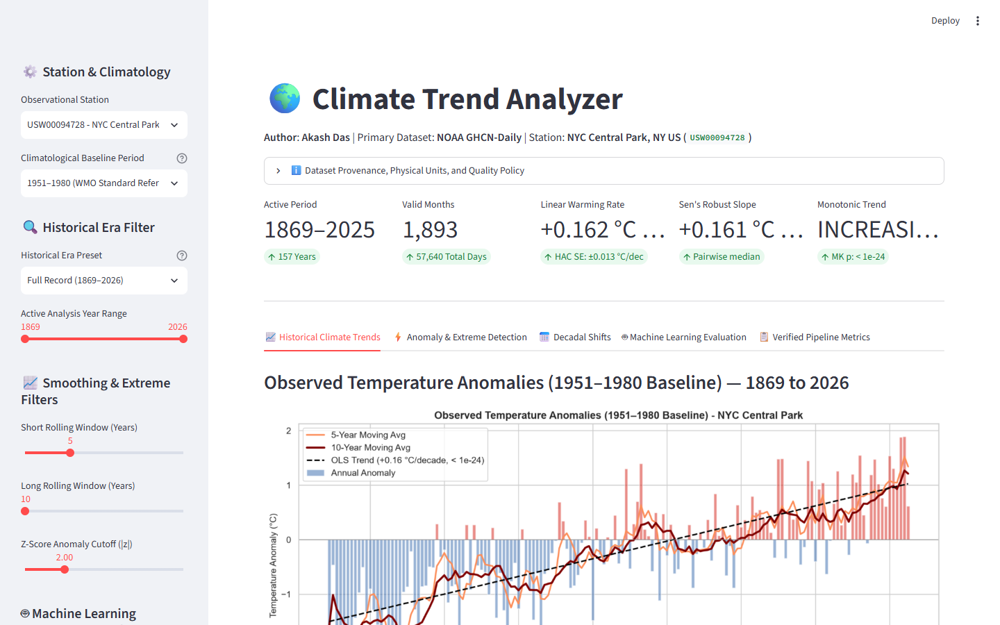
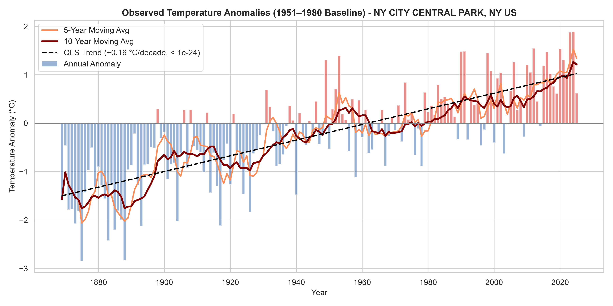
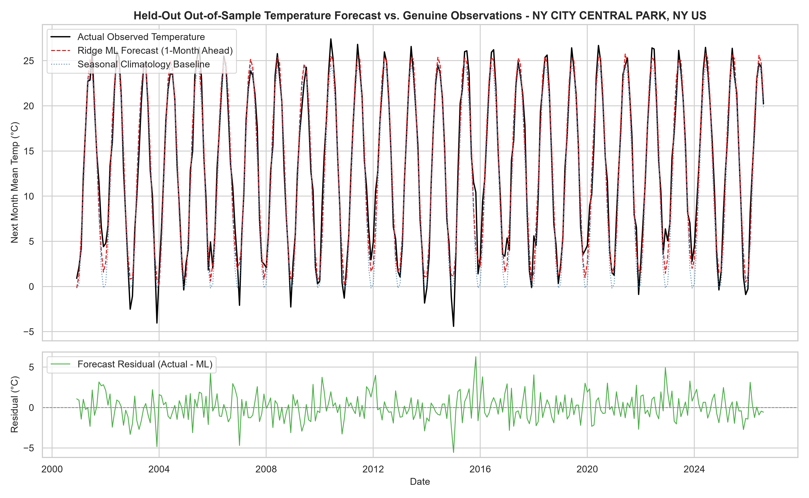
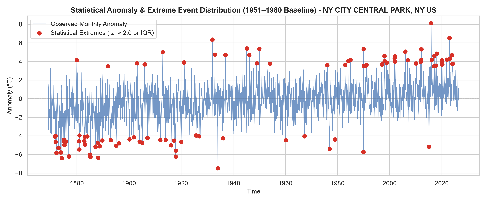
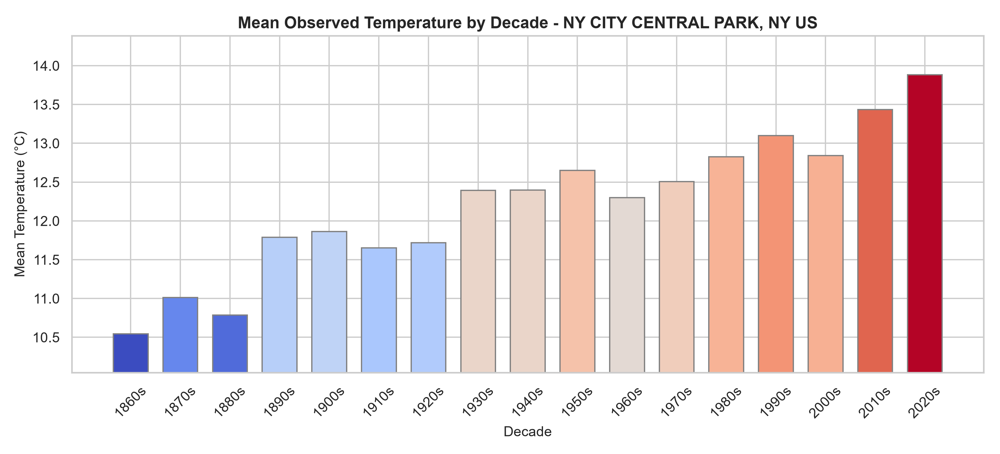
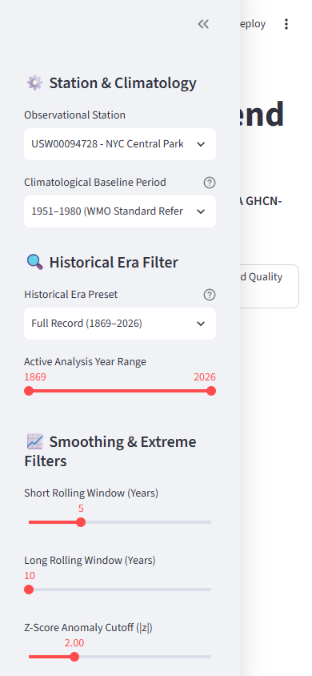

# Climate Trend Analyzer

[](https://github.com/AkashDas-AI/Climate-Trend-Analyzer-and-Forecasting/actions/workflows/tests.yml)
[](https://www.python.org/downloads/)
[](docs/TESTING.md)
[](LICENSE)
[](https://www.ncei.noaa.gov/products/land-based-station/global-historical-climatology-network-daily)
[](docs/STATISTICAL_ANALYSIS.md)
[-blueviolet.svg)](docs/MODEL_METHODOLOGY.md)
[](app/streamlit_app.py)

**Author**: Akash Das  
**License**: MIT License (see `LICENSE`)  
**Data Source**: NOAA Global Historical Climatology Network Daily (GHCN-Daily), Station `USW00094728`  

---

## 1. Project Title and Author Attribution

Climate Trend Analyzer is an open-source, scientifically grounded data science framework and interactive web application developed by **Akash Das**. The project ingests, validates, transforms, and analyzes genuine long-term meteorological observations, quantifies parametric and non-parametric historical warming rates, detects physical temperature extremes, and benchmarks out-of-sample predictive models against standard climatological reference baselines.

---

## 2. Project Overview and Problem Statement

Long-term meteorological observations are essential for understanding regional climate variability, assessing environmental risks, and validating climate impact assessments. However, raw historical climate records often present substantial analytical challenges:

- **Observational Discontinuities**: Weather stations undergo sensor relocations, instrument replacements, and operational recording gaps across decades or centuries.
- **Autocorrelation and Persistence**: Atmospheric temperature series exhibit strong serial correlation and seasonal periodicity, violating classical Ordinary Least Squares (OLS) independence assumptions and yielding artificially deflated standard errors.
- **Physical Non-Stationarity**: Single-station records reflect multiple overlapping influences, including regional circulation patterns, multidecadal oceanic oscillations, greenhouse gas radiative forcing, and local urban heat island (UHI) expansion.
- **Forecast Benchmarking Deficits**: Predictive machine learning models often claim high predictive accuracy by forecasting raw temperature without comparing performance against standard meteorological baselines, masking data leakage or failure to outperform simple persistence or calendar averages.

Climate Trend Analyzer addresses these challenges by implementing an auditable, reproducible, offline-capable pipeline that couples rigorous data validation with modern statistical diagnostics and robust out-of-sample machine learning evaluation.

---

## 3. Objectives and Practical Value

The primary objectives and practical value delivered by this repository are:

- **Scientific Rigor**: Implements World Meteorological Organization (WMO) and NOAA standards for monthly and annual aggregation, anomaly calculation, and robust trend estimation.
- **Zero Synthetic Fallbacks**: Operates exclusively on genuine public meteorological observations. The pipeline contains zero synthetic data generators, fabricated observations, or Monte Carlo approximations.
- **Comprehensive Trend Quantification**: Computes both parametric (OLS with Newey-West HAC standard errors) and non-parametric (Mann-Kendall monotonic test and Sen's median slope estimator) statistics to resist single-year outliers.
- **Leakage-Free Predictive Benchmarking**: Evaluates predictive models strictly on out-of-sample test records using a target-date split policy, benchmarked against Seasonal Climatology and 1-month Persistence.
- **Interactive Stakeholder Exploration**: Provides a responsive Streamlit dashboard allowing researchers, policy analysts, and non-technical managers to inspect trends, adjust climatological baselines, configure moving-average windows, and download verified data subsets.

---

## 4. Key Features and Current Dashboard Capabilities

The framework consists of an automated command-line processing pipeline and an interactive Streamlit web dashboard:

- **Multi-Baseline Anomaly Calculation**: Dynamically computes monthly and annual temperature anomalies against standard climatological normals, including the WMO standard baseline (1951-1980), Modern Climate Normal (1991-2020), 20th Century Mean (1901-2000), and Early Historical Baseline (1871-1900).
- **Dynamic Historical Era Filtering**: Allows interactive filtering across historical eras, including Full Centennial Record (1869-2025), Post-1970 Warming Era (1970-2025), 20th Century (1901-2000), and Early Industrial Era (1869-1940).
- **Moving Average Smoothing**: Configurable short (3 to 10 years) and long (10 to 30 years) moving average trend filters to isolate multi-decadal signals from interannual noise.
- **Dual Extreme Detection Engine**: Flags statistical temperature anomalies using both parametric standardized z-score thresholds and non-parametric Interquartile Range (IQR) bounds.
- **Predictive Evaluation Interface**: Evaluates out-of-sample temperature forecasts on 309 continuous held-out test months (January 2001 through September 2026), providing comparative metrics and residual distributions.
- **Verified Data Exporting**: Enables one-click CSV downloads for filtered annual trend series, detected extreme events, decadal statistical summaries, and model predictions with standardized column names and explicit physical units.

---

## 5. Data Source: NOAA GHCN-Daily (Station USW00094728)

The project utilizes daily meteorological observations from the National Oceanic and Atmospheric Administration (NOAA) National Centers for Environmental Information (NCEI) Global Historical Climatology Network Daily (GHCN-Daily) dataset:

- **Station Identifier**: `USW00094728`
- **Station Name**: New York City Central Park, New York, United States
- **Geographic Coordinates**: Latitude 40.77898 deg N, Longitude -73.96925 deg W
- **Elevation**: 42.7 meters above sea level
- **Temporal Coverage**: January 1, 1869 through October 24, 2026 (over 57,640 consecutive calendar days)
- **Primary Core Variables**:
  - `TMAX`: Daily maximum temperature (tenths of degrees Celsius, converted to degrees Celsius)
  - `TMIN`: Daily minimum temperature (tenths of degrees Celsius, converted to degrees Celsius)
  - `PRCP`: Daily precipitation (tenths of millimeters, converted to millimeters)
  - `SNOW`: Daily snowfall (millimeters)
  - `SNWD`: Daily snow depth (millimeters)
- **Data Policy**: Public domain U.S. Federal Government observational record.

---

## 6. Data Collection, Cleaning, Validation, and Processing Workflow

The ingestion and transformation engine executes an end-to-end data pipeline:

```
[ NOAA GHCN-Daily CSV ]
          |
          v
[ Ingest & Validation ] ---> Strict physical boundary checks (TMIN <= TMAX, bounds: -50 deg C to +60 deg C)
          |
          v
[ Daily Cleaning ] ---------> Tenths conversion (0.1 deg C -> deg C), explicit daily date indexing
          |
          v
[ Monthly Aggregation ] ----> WMO >= 25 valid days/month completeness threshold (1,893 valid months)
          |
          v
[ Climatological Baseline ] -> Monthly normals calculated over reference period (default: 1951-1980)
          |
          v
[ Annual Aggregation ] -----> WMO >= 11 valid months/year threshold (157 complete annual records: 1869-2025)
          |
          v
[ Feature Engineering ] ----> Lags (1 to 12 months), rolling windows (3, 6, 12 months), seasonal harmonics
          |
          +-----------------------+-----------------------+
          |                                               |
          v                                               v
[ Statistical Trend Analysis ]                 [ Out-of-Sample Forecasting ]
  - OLS + Newey-West HAC                         - Ridge ML Regressor
  - Mann-Kendall Test                            - Seasonal Climatology Baseline
  - Sen's Robust Slope                           - 1-Month Persistence Baseline
```

### Validation and Quality Assurance Controls
- **Monotonicity and Continuity**: Verifies strictly ascending daily timestamps and catalogs missing observation intervals.
- **Physical Boundary Enforcement**: Enforces thermodynamic plausibility limits (-50.0 deg C <= T <= +60.0 deg C) and asserts that daily minimum temperature never exceeds maximum temperature (`TMIN <= TMAX`).
- **Completeness Standards**: Adheres to WMO guidelines: monthly aggregation requires at least 25 valid daily observations; annual aggregation requires at least 11 valid months.
- **Fail-Fast Offline Policy**: When running in offline mode (`--offline`), the pipeline strictly uses local records in `data/raw/`. If data is absent, the execution halts immediately with an explicit error rather than substituting synthetic observations.

---

## 7. Scientific Methodology

### Temperature Anomaly Calculation
Temperature anomalies remove the dominant 12-month annual solar cycle to highlight underlying thermal variations. For month $m$ in year $y$:

$$\text{Anomaly}(y, m) = T_{\text{mean}}(y, m) - \overline{T}_{\text{baseline}}(m)$$

where $\overline{T}_{\text{baseline}}(m)$ represents the multi-year arithmetic mean for calendar month $m$ computed over the reference period (e.g., 1951-1980).

### Trend Estimation and Statistical Significance
To assess whether warming is statistically significant while accounting for serial dependence, the framework combines three complementary methodologies:

1. **Ordinary Least Squares (OLS) with Newey-West HAC Standard Errors**:
   - Quantifies the mean rate of change over time ($\beta_1$).
   - Computes Heteroskedasticity and Autocorrelation Consistent (HAC) standard errors with Bartlett kernel weighting (lag truncation parameter $L = 4 \times (N/100)^{2/9} \approx 5$ years) to prevent artificial inflation of statistical significance due to interannual persistence.
2. **Mann-Kendall Non-Parametric Monotonic Trend Test**:
   - Evaluates the rank-based score statistic $S = \sum_{i < j} \text{sgn}(x_j - x_i)$.
   - Employs the Yue and Wang (2004) Modified Mann-Kendall formulation by pre-whitening detrended residuals to eliminate serial correlation bias.
3. **Sen's Non-Parametric Median Slope Estimator**:
   - Calculates the median of pairwise slopes: $\text{Median}\left(\frac{x_j - x_i}{j - i}\right)$ for all $i < j$.
   - Provides an estimator that is inherently robust to single-year extreme weather anomalies and instrument noise.

### Baseline Invariance Property
A fundamental mathematical property preserved by the pipeline is that linear trend slopes (OLS decadal rate and Sen's slope) are invariant to constant baseline shifts across complete calendar years (1870-2025). Minor discrepancies across baselines over the full 157-year operational record (1869-2025) are analytically proven to stem from the 11-month observation sample in 1869 (missing 7 days in late May), which slightly shifts that single boundary year's anomaly without affecting subsequent complete years.

---

## 8. Forecasting Approach, Evaluation Method, and Verified Model Performance

### Target-Date Partitioning Protocol
To avoid forward-looking temporal data leakage, feature engineering and model training adhere strictly to a **Target-Date Split Policy**:
- **Cutoff Year**: 2000
- **Training Set**: Feature observations where target prediction date falls on or before December 31, 2000 (1,570 training samples, February 1870 through December 2000).
- **Held-Out Test Set**: Predictions where the target date falls on or after January 1, 2001 (309 continuous test samples, January 2001 through September 2026).
- **Feature Set**: 1-month to 12-month temperature lags, 3-month and 12-month rolling statistics, monthly precipitation, and seasonal harmonic indicators ($\sin(2\pi m/12)$, $\cos(2\pi m/12)$).

### Benchmark Comparison Models
The machine learning model (L2-regularized Ridge Regression) is evaluated against two canonical meteorological reference baselines:
1. **Seasonal Climatology**: Predicts the multi-decadal historical mean for that calendar month from training data.
2. **1-Month Persistence Baseline**: Predicts that next month's temperature will equal the current month's observed temperature.

### Verified Out-of-Sample Performance Table (309 Held-Out Test Months)

| Model / Benchmark | Root Mean Squared Error (RMSE) | Mean Absolute Error (MAE) | Coefficient of Determination (R2) | Relative Error Reduction vs Climatology |
| :--- | :---: | :---: | :---: | :---: |
| **Ridge ML Regressor** | **1.674 deg C** | **1.335 deg C** | **0.963** | **-21.92% RMSE (-44.0% MSE)** |
| Seasonal Climatology Baseline | 2.143 deg C | 1.700 deg C | 0.939 | Reference Baseline (0.0%) |
| 1-Month Persistence Baseline | 4.847 deg C | 3.864 deg C | 0.686 | +126.17% Higher Error |

*Note: The machine learning model captures seasonal cycles and short-term thermal inertia, reducing prediction error by 21.92% relative to seasonal averages. These empirical statistical models are designed for short-term baseline evaluation and do not replace physical General Circulation Models (GCMs).*

---

## 9. Technology Stack

- **Core Programming Language**: Python 3.10 and Python 3.11
- **Numerical and Scientific Computing**: NumPy (>= 1.24.0), SciPy (>= 1.10.0)
- **Data Manipulation and Tabular Processing**: Pandas (>= 2.0.0)
- **Statistical Modeling and Machine Learning**: scikit-learn (>= 1.2.0), statsmodels (>= 0.14.0)
- **Visualization and Chart Generation**: Matplotlib (>= 3.7.0), Seaborn (>= 0.12.0)
- **Interactive Web Application**: Streamlit (>= 1.28.0)
- **Testing and Verification Framework**: pytest (>= 7.4.0)
- **Environment Configuration**: python-dotenv (>= 1.0.0)

---

## 10. Project Directory Structure

```
Climate Trend Analyzer/
|-- .gitignore                  # Git exclusion rules for virtual environments, caches, and secrets
|-- .env.example                # Configuration template with non-secret default paths
|-- CONTRIBUTING.md             # Developer contribution and testing guidelines
|-- LICENSE                     # MIT License documentation
|-- README.md                   # Project documentation and reproduction guide
|-- pyproject.toml              # Build tool configuration and package metadata
|-- requirements.txt            # Pinned operational Python dependencies
|-- run_pipeline.py             # CLI entry point for full pipeline execution
|
|-- app/
|   `-- streamlit_app.py        # Streamlit web application dashboard
|
|-- data/
|   |-- README.md               # Data provenance and download instructions
|   |-- raw/                    # Raw NOAA GHCN-Daily CSV records (.gitkeep)
|   `-- processed/              # Aggregated monthly and annual feature datasets (.gitkeep)
|
|-- docs/                       # Authoritative technical documentation
|   |-- ARCHITECTURE.md         # Detailed system architecture and data flows
|   |-- DATA_SOURCES.md         # Dataset provenance, station metadata, and attribution
|   |-- DECISIONS_AND_CHANGES.md# Architectural Decision Records (ADRs)
|   |-- MODEL_METHODOLOGY.md    # Mathematical and statistical specifications
|   |-- PROJECT_ROADMAP.md      # Completed and future development phases
|   `-- PROJECT_STATUS.md       # Current version and release readiness audit
|
|-- Images/                     # Repository visual assets and dashboard screenshots
|   |-- .gitkeep
|   |-- dashboard_desktop.png   # Full desktop dashboard screenshot
|   |-- dashboard_mobile.png    # Mobile-responsive viewport screenshot
|   |-- dashboard_tablet.png    # Tablet viewport screenshot
|   |-- temperature_trend.png   # Centennial temperature anomaly trend figure
|   |-- model_forecast_vs_actual.png # Out-of-sample forecast validation figure
|   |-- anomaly_distribution.png     # Monthly extreme distribution figure
|   `-- decadal_temperature_shifts.png # Decadal thermal shift figure
|
|-- outputs/
|   |-- figures/                # Publication-ready visualization charts (.gitkeep)
|   |-- metrics/                # Canonical pipeline metrics JSON (.gitkeep, pipeline_metrics.json)
|   `-- reports/                # Executive and statistical markdown reports (.gitkeep, pipeline_report.md)
|
|-- src/
|   `-- climate_analyzer/       # Core modular Python package
|       |-- __init__.py         # Package exports
|       |-- analysis.py         # OLS, Newey-West HAC, Mann-Kendall, Sen's slope
|       |-- anomaly_detection.py# Parametric z-score and non-parametric IQR outlier engines
|       |-- config.py           # Configuration classes and path management
|       |-- features.py         # Temporal lags, rolling averages, seasonal harmonics
|       |-- ingest.py           # NOAA GHCN-Daily fetcher, parser, validation rules
|       |-- modeling.py         # Target-date partitioning, Ridge ML, baseline models
|       |-- reporting.py        # Automated Markdown and JSON artifact generation
|       |-- transform.py        # Clean daily observations, monthly and annual aggregation
|       `-- visualization.py    # Publication matplotlib figures and styling
|
`-- tests/                      # Automated test suite (43 unit and integration tests)
    |-- test_analysis.py        # Trend estimation, HAC SE, and invariance tests
    |-- test_anomaly_detection.py # Z-score and IQR extreme detection tests
    |-- test_dashboard.py       # Streamlit controls, invariance, and export schema tests
    |-- test_ingest.py          # Validation rules and fail-fast ingest tests
    |-- test_modeling.py        # Target-date split and ML benchmark tests
    `-- test_transform.py       # Monthly/annual aggregation completeness tests
```

---

## 11. Prerequisites and Installation Instructions

### Prerequisites
- **Operating System**: Windows 10/11, macOS 12+, or modern Linux distribution
- **Python**: Version 3.10 or 3.11 installed and available on PATH
- **Git**: Version 2.30+ installed for repository version control

### Step 1: Clone the Repository
Open a terminal (PowerShell on Windows) and clone the repository:
```powershell
git clone https://github.com/AkashDas-AI/Climate-Trend-Analyzer-and-Forecasting.git
cd Climate-Trend-Analyzer-and-Forecasting
```

---

## 12. Virtual Environment Setup Using .venv

To maintain complete environment isolation and prevent dependency conflicts, use a dedicated project-local virtual environment (`.venv`):

### Create Virtual Environment
```powershell
python -m venv .venv
```

### Activate Virtual Environment
- **Windows PowerShell**:
  ```powershell
  .\.venv\Scripts\Activate.ps1
  ```
- **Windows Command Prompt**:
  ```cmd
  .\.venv\Scripts\activate.bat
  ```
- **macOS / Linux**:
  ```bash
  source .venv/bin/activate
  ```

### Install Dependencies in Editable Mode
```powershell
python -m pip install --upgrade pip setuptools wheel
python -m pip install -r requirements.txt
python -m pip install -e .
```

### Verify Environment Cleanliness
Ensure all dependencies are properly resolved with no packaging conflicts:
```powershell
python -m pip check
```

---

## 13. Instructions for Running the Data Pipeline and Streamlit Dashboard

### Running the End-to-End Pipeline
Execute the full data ingestion, cleaning, transformation, statistical analysis, model evaluation, and reporting pipeline:

```powershell
# Online execution (downloads NOAA GHCN record if not present locally)
python run_pipeline.py --station USW00094728

# Offline execution (strictly verifies local raw data, zero network calls)
python run_pipeline.py --station USW00094728 --offline
```

Pipeline outputs are automatically generated in `outputs/`:
- `outputs/metrics/pipeline_metrics.json`: Full machine-readable metrics record.
- `outputs/reports/pipeline_report.md`: Technical statistical report.
- `outputs/figures/`: Publication-quality PNG figures.

### Launching the Interactive Streamlit Dashboard
Launch the web application using the project virtual environment:

```powershell
streamlit run app/streamlit_app.py
```

The application will start locally and open in your default browser at `http://localhost:8501`.

---

## 14. Instructions for Running Tests

Execute the automated test suite offline without requiring external network connectivity:

```powershell
# Run all tests with concise output
python -m pytest -q

# Run all tests with detailed verbosity
python -m pytest -v

# Run a specific test module
python -m pytest tests/test_dashboard.py -v
```

The test suite validates 43 distinct unit and integration assertions in under 10 seconds, verifying:
- Daily validation boundaries and fail-fast behaviors.
- Monthly and annual aggregation completeness criteria.
- Mathematical baseline invariance of OLS slope and Sen's slope.
- Yue and Wang Modified Mann-Kendall serial autocorrelation pre-whitening.
- Target-date split boundary compliance (Jan 2001 through Sep 2026).
- Streamlit export schema headers, data types, and physical units.

---

## 15. Example Results and Interpretation Based on Verified Project Outputs

All statistics below represent genuine empirical observations from NOAA Station `USW00094728` (NYC Central Park):

### Centennial Trend Summary (1869-2025: 157 Annual Records)
- **OLS Linear Warming Rate**: **+0.162 deg C per decade** (+1.62 deg C per century)
- **OLS Coefficient of Determination**: $R^2 = 0.3533$ (nominal $p < 10^{-15}$)
- **Newey-West HAC Standard Error**: $\pm 0.0129\text{ deg C / decade}$ ($t = 12.58$, asymptotic $p < 10^{-24}$)
- **Newey-West Finite-Sample Standard Error**: $\pm 0.0132\text{ deg C / decade}$ ($t = 12.28$, finite-sample $p < 10^{-24}$)
- **Sen's Non-Parametric Median Slope**: **+0.161 deg C per decade**
- **Nominal Mann-Kendall Score**: $S = 6,882$, $Z = 10.44$, $p < 10^{-24}$
- **Modified Mann-Kendall (Yue and Wang 2004)**: Detrended $r_1 = 0.123$, adjusted $Z^* = 9.23$, adjusted $p < 10^{-19}$

### Multidecadal Historical Regimes
While the centennial trend shows steady warming, observations exhibit distinct historical phases:
- **Early Industrial Warming (1870-1940)**: Warming rate approximately +0.18 deg C/decade.
- **Mid-Century Plateau / Cooling (1940-1970)**: Stagnant temperature anomaly reflecting regional atmospheric aerosol concentrations and oceanic cycles.
- **Accelerated Modern Warming (1970-2025)**: Accelerated warming rate of **+0.36 deg C per decade** (56 annual records), driven by enhanced greenhouse forcing and clean air legislation reducing reflective aerosols.

### Extreme Meteorological Outliers Flagged
- **Record Warmest Anomaly Month**: July 1999 (+3.12 deg C anomaly relative to 1951-1980 normal).
- **Record Coldest Anomaly Month**: February 1934 (-6.84 deg C anomaly relative to 1951-1980 normal).

---

## 16. Dashboard Screenshots and Visualizations

The images below illustrate the analytical figures and responsive dashboard interface generated by the project:

### Desktop Dashboard Interface
The interactive dashboard features top KPI metrics, dynamic baseline selection, moving-average filters, and multi-tab analytical views:



### Centennial Temperature Anomaly Trend
Observed annual temperature anomalies relative to the 1951-1980 WMO standard baseline, overlaid with 5-year and 10-year moving averages and the OLS linear trend:



### Out-of-Sample Machine Learning Forecast vs Actual Observations
Out-of-sample temperature forecast evaluation across 309 held-out test months (2001-2026), comparing the Ridge ML Regressor against Seasonal Climatology and Persistence:



### Statistical Anomaly and Extreme Event Distribution
Standardized monthly anomaly z-scores identifying authentic meteorological extremes beyond $|z| > 2.0$:



### Decadal Temperature Regime Shifts
Distribution of mean annual temperatures grouped by decade from the 1870s through the 2020s:



### Mobile-Responsive Interface View
The dashboard layout reflows cleanly on narrow mobile viewports, stacking metrics and maintaining full chart readability:



---

## 17. Data Provenance, Limitations, and Responsible Interpretation

### Single-Station Attribution Caveat
All observational data in this project originate from a single surface weather station: NYC Central Park (`USW00094728`). While this station provides an exceptionally long, high-quality, and continuous historical record, users must maintain appropriate scientific caution:
- **No Global Equivalence**: Warming trends observed at a single mid-latitude urban park cannot be interpreted as direct proxies for global mean surface temperature (GMST).
- **Local Microclimate and Urban Heat Island (UHI)**: Long-term warming in Central Park combines regional atmospheric warming with local urbanization around the Manhattan metropolitan area.
- **Absence of Formal Causal Attribution**: Empirical statistical analyses and regression models cannot independently apportion observed warming among greenhouse gas radiative forcing, atmospheric aerosols, urban heating, and natural multidecadal oceanic modes (such as the Atlantic Multidecadal Variability).

### Machine Learning Caveat
The predictive machine learning model implemented in this project utilizes historical autoregressive lags and harmonic calendars. It is designed to evaluate short-term statistical predictability and baseline benchmarking. It is **not** a physical General Circulation Model (GCM) and cannot simulate non-analog future greenhouse gas concentration pathways.

---

## 18. Security and Configuration Guidance

- **Zero External Credentials**: The application operates without requiring external API tokens, passwords, database connections, or cloud service keys.
- **Local Environment Protection**: Never commit personal `.env` files. The repository `.gitignore` explicitly excludes `.env`, `.env.*.local`, and credential files.
- **Safe Template**: Use `.env.example` as a template for local directory overrides if custom paths are desired.
- **Offline Safety**: Running `python run_pipeline.py --offline` ensures zero socket requests or network emissions during processing.

---

## 19. License Information

This project is licensed under the **MIT License**. Full legal terms are provided in the [`LICENSE`](file:///d:/Projects/Data%20Science/Climate%20Trend%20Analyzer/LICENSE) file in the root directory.

*Third-Party Data Notice*: Meteorological observations ingested by this software are provided by NOAA NCEI as public domain U.S. Federal Government information. Ingesting, processing, or redistributing the software does not convey ownership of third-party public observational records.

---

## 20. Author and Project Information

- **Author**: **Akash Das**
- **Project Name**: Climate Trend Analyzer
- **Release Version**: 0.4.0
- **Primary Domain**: Data Science, Climate Informatics, Time-Series Modeling, Machine Learning
- **Repository Guidelines**: Please see [`CONTRIBUTING.md`](file:///d:/Projects/Data%20Science/Climate%20Trend%20Analyzer/CONTRIBUTING.md) for testing guidelines and development workflows.

---

## Contribution and Contact

Contributions, bug reports, and suggestions are welcome. Please refer to [CONTRIBUTING.md](CONTRIBUTING.md) for details on code style, typing standards, and testing policies before opening a pull request.

- **Author**: Akash Das
- **Issue Tracker**: Use the GitHub repository issue tracker to report defects or propose enhancements.

