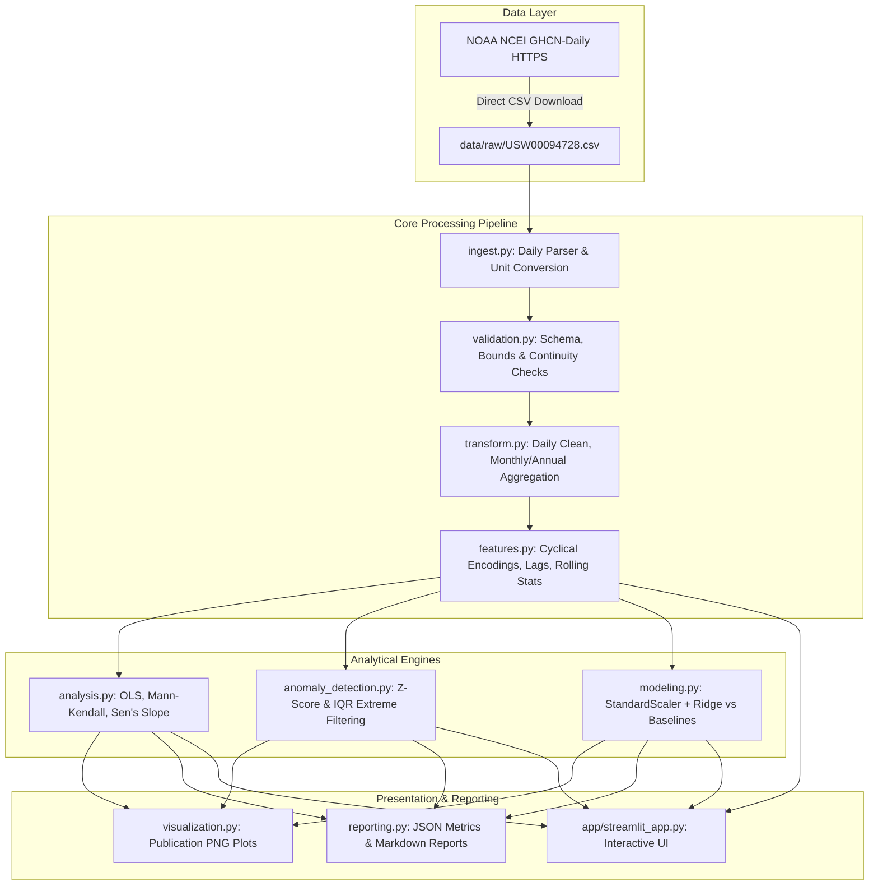

# Architecture & Module Specifications

This document defines the software engineering architecture, directory layout, and internal component interfaces for the **Climate Trend Analyzer**.

**Author**: Akash Das  
**Current Status**: Complete & Verified (Real Public Data Only)  

---

## 1. System Topology & Package Layout

The project follows the modern Python `src/` layout configured via `pyproject.toml`, built strictly around genuine, public meteorological observations:

```
Climate Trend Analyzer/
├── .github/workflows/tests.yml   # Continuous Integration test matrix (Python 3.10 & 3.11)
├── app/                          # Interactive dashboard application
│   ├── __init__.py
│   └── streamlit_app.py          # Streamlit UI for real public data
├── data/                         # Data layer (strictly local, git-ignored)
│   ├── raw/                      # Downloaded NOAA GHCN station CSVs (USW00094728.csv)
│   └── processed/                # Monthly & annual aggregated features
├── docs/                         # Authoritative centralized documentation suite
│   ├── README.md                 # Master documentation index
│   ├── ARCHITECTURE.md           # System architecture & module interfaces (this file)
│   ├── DATA_FLOW.md              # End-to-end data pipeline flow & schemas
│   ├── DATA_PROCESSING.md        # Cleaning, aggregation, and baseline methods
│   ├── DATA_SOURCES.md           # NOAA GHCN-Daily provenance & attribution
│   ├── DATA_DICTIONARY.md        # Column definitions, units, and ranges
│   ├── FEATURE_ENGINEERING.md    # Cyclical, lag, and rolling features
│   ├── MODEL_METHODOLOGY.md      # ML forecasting, StandardScaler, and baselines
│   ├── STATISTICAL_ANALYSIS.md   # OLS, Mann-Kendall, Sen's slope, and extremes
│   ├── DASHBOARD_AND_OUTPUTS.md  # Streamlit UI & exported figures catalog
│   ├── TESTING.md                # Test philosophy & 22-test matrix
│   ├── EXECUTION_LOG.md          # Chronological execution & command history
│   ├── DECISIONS_AND_CHANGES.md  # Architecture decision records (ADRs)
│   ├── LIMITATIONS.md            # Scientific boundaries & caveats
│   └── PROJECT_STATUS.md         # Current status & verification summary
├── notebooks/                    # Jupyter analysis notebooks
├── outputs/                      # Generated figures, metrics, and reports
│   ├── figures/                  # Publication-ready PNG plots
│   ├── metrics/                  # pipeline_metrics.json
│   └── reports/                  # pipeline_report.md
├── reports/                      # High-level summary report (PROJECT_REPORT.md)
├── src/climate_analyzer/         # Core installable Python package
│   ├── __init__.py               # Package metadata and version
│   ├── config.py                 # Paths, station IDs, URLs, baseline definitions
│   ├── ingest.py                 # NOAA GHCN downloader and daily parser
│   ├── validation.py             # Schema, timestamp, continuity, and bounds checks
│   ├── transform.py              # Cleaning, monthly/annual grouping, baseline anomalies
│   ├── features.py               # Cyclical month encodings, autoregressive lags, rolling stats
│   ├── analysis.py               # Linear trends (OLS), Mann-Kendall test, Sen's slope
│   ├── anomaly_detection.py      # Z-score, IQR, and extreme record ranking
│   ├── modeling.py               # Ridge regression pipeline vs. climatological baselines
│   ├── visualization.py          # Publication-ready static & interactive plots
│   └── reporting.py              # Metric export and markdown report generation
├── tests/                        # Comprehensive unit test suite (43 in-memory unit tests)
├── run_pipeline.py               # Top-level CLI execution entry point
├── pyproject.toml                # Build system, metadata, and dependencies
└── requirements.txt              # Pinned/minimum environment dependencies
```

---

## 2. Module Responsibilities & Contracts

| Module | Primary Functionality | Public Interfaces |
| :--- | :--- | :--- |
| [`config.py`](file:///d:/Projects/Data%20Science/Climate%20Trend%20Analyzer/src/climate_analyzer/config.py) | Centralizes all project paths, NOAA station codes, URLs, and baseline years | `get_project_paths()`, `Config` |
| [`ingest.py`](file:///d:/Projects/Data%20Science/Climate%20Trend%20Analyzer/src/climate_analyzer/ingest.py) | Downloads and parses genuine NOAA GHCN-Daily tables | `download_noaa_ghcn_station()`, `load_noaa_ghcn_daily()`, `load_climate_dataset()` |
| [`validation.py`](file:///d:/Projects/Data%20Science/Climate%20Trend%20Analyzer/src/climate_analyzer/validation.py) | Validates column types, temporal continuity, monotonicity, bounds | `validate_ghcn_dataframe()`, `ClimateDataValidationError` |
| [`transform.py`](file:///d:/Projects/Data%20Science/Climate%20Trend%20Analyzer/src/climate_analyzer/transform.py) | Daily cleaning, monthly/annual grouping, 1951–1980 baseline anomalies | `clean_daily_observations()`, `aggregate_to_monthly()`, `compute_climatological_anomalies()`, `aggregate_to_annual()` |
| [`features.py`](file:///d:/Projects/Data%20Science/Climate%20Trend%20Analyzer/src/climate_analyzer/features.py) | Computes cyclical month features, lookback lags, and rolling averages | `engineer_monthly_features()`, `engineer_annual_features()` |
| [`analysis.py`](file:///d:/Projects/Data%20Science/Climate%20Trend%20Analyzer/src/climate_analyzer/analysis.py) | Computes OLS, Mann-Kendall test statistic, Sen's slope, and decadal summaries | `calculate_linear_trend()`, `mann_kendall_test()`, `sens_slope()`, `calculate_decadal_summary()` |
| [`anomaly_detection.py`](file:///d:/Projects/Data%20Science/Climate%20Trend%20Analyzer/src/climate_analyzer/anomaly_detection.py) | Flags statistical outliers (Z-score, IQR, top record extremes) | `detect_zscore_anomalies()`, `detect_iqr_anomalies()`, `get_top_extreme_records()`, `detect_anomalies()` |
| [`modeling.py`](file:///d:/Projects/Data%20Science/Climate%20Trend%20Analyzer/src/climate_analyzer/modeling.py) | Scaled Ridge ML forecasting vs. Seasonal Climatology & Persistence baselines | `temporal_train_test_split()`, `train_and_evaluate_climate_model()` |
| [`visualization.py`](file:///d:/Projects/Data%20Science/Climate%20Trend%20Analyzer/src/climate_analyzer/visualization.py) | Generates and exports publication-quality figures | `plot_historical_temperature_trend()`, `plot_anomalies()`, `plot_decadal_temperature_shifts()`, `plot_model_forecast_vs_actual()` |
| [`reporting.py`](file:///d:/Projects/Data%20Science/Climate%20Trend%20Analyzer/src/climate_analyzer/reporting.py) | Compiles summary metrics and exports structured markdown | `generate_markdown_report()`, `export_metrics()` |

---

## 3. End-to-End Real-Data Architecture Flow


