# Dashboard Architecture & Generated Outputs Catalog

This document details the user interface architecture of the interactive Streamlit application, the catalog of exported publication-ready figures, and the structured schema of pipeline metrics and reports.

**Project Author**: Akash Das  
**Application Entry Point**: [`app/streamlit_app.py`](file:///d:/Projects/Data%20Science/Climate%20Trend%20Analyzer/app/streamlit_app.py)  
**Output Directories**:  
- [`outputs/figures/`](file:///d:/Projects/Data%20Science/Climate%20Trend%20Analyzer/outputs/figures)  
- [`outputs/metrics/`](file:///d:/Projects/Data%20Science/Climate%20Trend%20Analyzer/outputs/metrics)  
- [`outputs/reports/`](file:///d:/Projects/Data%20Science/Climate%20Trend%20Analyzer/outputs/reports)  

---

## 1. Streamlit Dashboard Architecture

The interactive dashboard is implemented in [`app/streamlit_app.py`](file:///d:/Projects/Data%20Science/Climate%20Trend%20Analyzer/app/streamlit_app.py) using the modern Streamlit framework. It provides a real-time exploration interface for genuine NOAA observational records and machine learning forecasts.

### 1.1 UI Layout & Design
- **Wide Mode**: Utilizes full screen real estate (`layout="wide"`).
- **Metadata Header**: Displays station details (NOAA Station ID `USW00094728`, Station Name, Coordinates `40.77898° N, -73.96925° W`, Elevation `42.7 m`, Observation Span `1869–2026`, and Reference Baseline).
- **Provenance & Quality Policy Expander**: Outlines physical units (°C, mm), operational midpoint temperature definition ($T_{\text{mid}} = (T_{\text{max}} + T_{\text{min}}) / 2.0$), completeness rules ($\ge 25$ days/mo, un-interpolated May 1869 gap), and the strict real-data guarantee.
- **Top 5-Column Responsive KPI Row**:
  - Active Analysis Period (e.g., `1869–2026 (157 Years)`)
  - Valid Months Count (e.g., `1,893 Valid Months / 57,640 Days`)
  - Linear Warming Rate (with Newey-West HAC standard error, e.g., `+0.162 °C / dec`)
  - Sen's Robust Median Slope (`+0.161 °C / dec`)
  - Monotonic Trend Classification (Mann-Kendall $p < 10^{-24}$)
- **Interactive Sidebar Controls**:
  - **Station Selector**: `USW00094728 - NYC Central Park, NY`.
  - **Climatological Baseline Selector**: Dynamically recalculates monthly and annual anomalies for:
    - `1951–1980 (WMO Standard Reference)` [Default]
    - `1901–2000 (20th Century Climatology)`
    - `1991–2020 (Modern 30-Year Normal)`
    - `1871–1900 (Early Historical Reference)`
    - `Custom Range...`
  - **Historical Era / Year-Range Filter**: Dual slider (`1869` to `2026`) with quick presets ("Full Record", "Post-1970 Warming Era", "20th Century", "Early Historical"). Dynamically recomputes trends and decadal summaries for the selected era.
  - **Smoothing Windows**: Configurable short (3–10 yrs) and long (10–30 yrs) rolling moving averages.
  - **Extreme Cutoff Filter**: Z-score cutoff ($|z| \in [1.5, 3.5]$).
  - **Forecast Evaluation Protocol**: Switch between `Validated Benchmark (Targets 2001–2026, 309 Held-Out Months)` and `Exploratory Split Year (Custom Scenario)`.

### 1.2 Dashboard Tabs

```mermaid
flowchart TD
    App[Streamlit Web App] --> T1[Tab 1: Historical Trends]
    App --> T2[Tab 2: Extreme Events & Outliers]
    App --> T3[Tab 3: Decadal Shifts]
    App --> T4[Tab 4: Machine Learning Forecasting]
    App --> T5[Tab 5: Verified Pipeline Metrics]

    T1 --> P1[Annual Anomaly Timeline & Rolling Smoothers]
    T1 --> E1[Statistical Diagnostics Expander: HAC SE, Sen, MK, Yue-Wang]
    T1 --> D1[CSV Download: Filtered Annual Trends]

    T2 --> P2[Monthly Anomaly Timeline & Highlighted Outliers]
    T2 --> DT1[Top 10 Warmest & Coldest Years Tables]
    T2 --> D2[CSV Download: Detected Monthly Extremes]

    T3 --> P3[Decadal Progression Bar Chart]
    T3 --> DT2[Decadal Statistical Summary Table]
    T3 --> D3[CSV Download: Decadal Climate Summary]

    T4 --> C1[Benchmark KPI Metrics: Ridge vs Climatology vs Persistence]
    T4 --> P4[Out-of-Sample Test Forecast vs Observations 2001-2026]
    T4 --> DT3[Model Feature Importance / Standardized Weights Table]
    T4 --> D4[CSV Download: Held-Out ML Predictions & Residuals]

    T5 --> J1[Raw JSON Inspector: pipeline_metrics.json]
```



#### Tab 1: Historical Climate Trends
- **Dynamic Charting**: Annual mean temperature anomaly timeline with configurable moving averages and OLS trendline, labeled with the active baseline and era.
- **Statistical Expander**: Reports OLS decadal rate, $R^2$, nominal $p$-value, Newey-West HAC asymptotic and finite-sample standard errors, Sen's slope, and Modified Mann-Kendall statistics.
- **CSV Download**: `Download Filtered Annual Trends CSV` containing `year`, `mean_annual_temp_degC`, `temperature_anomaly_degC`, `moving_avg_{w1}yr_degC`, `moving_avg_{w2}yr_degC`, `baseline_period`, and `station_id`. Header column names dynamically adapt to the selected slider window lengths (e.g. `moving_avg_3yr_degC`, `moving_avg_15yr_degC`).

#### Tab 2: Extreme Events & Anomalies
- **Configurable Cutoff**: Highlights monthly anomalies exceeding $|z| > \text{threshold}$ as authentic severe events.
- **Rankings**: Side-by-side Top 10 Warmest and Top 10 Coldest Years tables.
- **CSV Download**: `Download Detected Monthly Extremes CSV` containing `date`, `year`, `month`, `mean_temp_degC`, `temperature_anomaly_degC`, `standardized_z_score`, `flag_zscore_extreme`, `flag_iqr_extreme`, and `z_threshold_applied`.

#### Tab 3: Decadal Shifts
- **Progression Plot**: Decadal bar chart mapped with cool-to-warm color gradients.
- **Summary Table**: Full decadal distribution (mean, standard deviation, min, max, count).
- **CSV Download**: `Download Decadal Climate Summary CSV` containing `decade`, `mean_annual_temp_degC`, `std_annual_temp_degC`, `min_annual_temp_degC`, `max_annual_temp_degC`, and `valid_years_count`.

#### Tab 4: Machine Learning Forecasting
- **Benchmark Alignment**: Preserves the authoritative Target-Date Split Policy (targets $\le 2000$ train; targets $\ge 2001$ test; 309 held-out months). Custom splits are explicitly labeled as exploratory scenarios.
- **Comparative Metrics**: Displays Ridge Regressor (RMSE 1.674 °C, MAE 1.335 °C, $R^2 = 0.963$, **21.92% RMSE reduction**), Seasonal Climatology (RMSE 2.143 °C), and Persistence (RMSE 4.847 °C).
- **Feature Weights**: Expander with standardized regression coefficients (`tavg_mean`, `cos_month`, `sin_month`, `rolling_tavg_3m`, `tavg_lag_12`, `tavg_lag_1`, etc.).
- **CSV Download**: Dedicated download buttons with distinct filenames and metadata:
  - **Validated Benchmark Mode**: Filename `{station_id}_ml_benchmark_predictions_2001_2026_309months.csv` with `forecast_protocol = "validated_benchmark"`.
  - **Exploratory Scenario Mode**: Filename `{station_id}_ml_exploratory_predictions_split{split_yr}.csv` with `forecast_protocol = "exploratory_scenario"`.
  - **CSV Schema**: `feature_date`, `target_date`, `actual_observed_tavg_degC`, `predicted_ridge_ml_degC`, `predicted_climatology_degC`, `predicted_persistence_degC`, `forecast_residual_degC`, `split_year`, `forecast_protocol`, `station_id`.

#### Tab 5: Verified Pipeline Metrics
- Inspects authoritative quantitative outputs directly from [`outputs/metrics/pipeline_metrics.json`](file:///d:/Projects/Data%20Science/Climate%20Trend%20Analyzer/outputs/metrics/pipeline_metrics.json) to confirm perfect synchrony between dashboard views and pipeline artifacts.

### 1.3 Baseline Invariance Principles, Sample Conditioning & Statistical Reconciliation

A central scientific question explored in Phase 7A-R1 and reconciled in Phase 7A-R2 is the **exact condition under which climate trend statistics are invariant to climatological baseline selection**.

#### 1.3.1 Mathematical Proof on Complete Calendar Years
Let $T_{y, m}$ denote the monthly mean temperature for year $y$ and calendar month $m$.
For a chosen reference baseline period $B_1$, the climatological normal for calendar month $m$ is $\bar{T}_{m}^{(1)} = \frac{1}{|B_1|} \sum_{y \in B_1} T_{y, m}$.
The monthly anomaly is $a_{y, m}^{(1)} = T_{y, m} - \bar{T}_{m}^{(1)}$.
For any year $y$ with valid month set $\mathcal{M}_y$ of size $M_y = |\mathcal{M}_y|$:
$$A_y^{(1)} = \frac{1}{M_y} \sum_{m \in \mathcal{M}_y} (T_{y, m} - \bar{T}_{m}^{(1)}) = \bar{T}_y - \bar{B}_y^{(1)}, \quad \text{where } \bar{B}_y^{(1)} = \frac{1}{M_y} \sum_{m \in \mathcal{M}_y} \bar{T}_{m}^{(1)}$$

**Condition A: Complete Calendar Years ($M_y = 12$ for all $y$)**:
When every annual observation contains all 12 calendar months (such as 1870–2025, N=156, or filtered dashboard eras like 1970–2025, N=56):
$\bar{B}_y^{(1)} = \frac{1}{12} \sum_{m=1}^{12} \bar{T}_{m}^{(1)} = \bar{B}^{(1)}$ is a single scalar constant for all years.
When changing the reference baseline to period $B_2$:
$$A_y^{(2)} = \bar{T}_y - \bar{B}^{(2)} = A_y^{(1)} + C, \quad \text{where } C = \bar{B}^{(1)} - \bar{B}^{(2)} \text{ is constant for all } y.$$

Under this pure scalar translation:
1. **OLS Slope Invariance**:
   $$\hat{\beta} = \frac{\sum (y - \bar{y})(A_y - \bar{A})}{\sum (y - \bar{y})^2}$$
   Because $(A_y + C) - (\bar{A} + C) \equiv A_y - \bar{A}$, the slope $\hat{\beta}_{\text{OLS}} \equiv 0.1616656417$ °C/decade is **bit-for-bit identical ($< 10^{-15}$)** across all baselines.
   Residuals $\epsilon_y = A_y - (\hat{\alpha} + \hat{\beta} y)$ and $R^2$ are identical, so Newey-West HAC standard errors ($0.013189$ °C/dec) and $t$-statistics ($12.257$) are strictly invariant.
2. **Sen's Median Slope Invariance**:
   For any pair of years $(i, j)$:
   $$S_{i, j}^{(2)} = \frac{(A_j^{(1)} + C) - (A_i^{(1)} + C)}{j - i} = \frac{A_j^{(1)} - A_i^{(1)}}{j - i} = S_{i, j}^{(1)}$$
   Because every pairwise slope is bit-for-bit identical, $\text{Median}(S_{i, j}) \equiv 0.1605398819$ °C/decade across all baselines.
3. **Mann-Kendall Monotonic Score**:
   $\text{sign}(A_j^{(2)} - A_i^{(2)}) = \text{sign}(A_j^{(1)} - A_i^{(1)})$, so $S \equiv 6,754$ and $Z \equiv 10.348448$ are strictly invariant.

#### 1.3.2 The 1869 Incomplete Year Leverage Effect (Phase 7A-R1 Discrepancy Reconciliation)
In Phase 7A-R1 Table 3.2, small differences were reported at the 5th and 6th decimal places on the full 157-year operational record (1869–2025):
- 1951–1980 WMO: OLS $+0.161834$ °C/dec, Sen $+0.161029$ °C/dec
- 1901–2000 20th Cent: OLS $+0.161832$ °C/dec, Sen $+0.161029$ °C/dec
- 1991–2020 Modern: OLS $+0.161895$ °C/dec, Sen $+0.161038$ °C/dec
- 1871–1900 Early: OLS $+0.161741$ °C/dec, Sen $+0.160794$ °C/dec

**Root Cause**:
Year 1869 has only 11 valid months ($M_{1869} = 11$, May 1869 was excluded due to the authentic 7-day observation gap).
Because atmospheric warming in NYC is seasonally non-uniform (winter warmed by $+1.0$ to $+1.5$ °C, while May warmed by $+0.34$ °C), the 11-month average baseline offset for 1869 differs from the 12-month average offset for 1870–2025:
- Modern (1991–2020) vs WMO (1951–1980): $\delta = -0.02516$ °C
- Early (1871–1900) vs WMO (1951–1980): $\delta = +0.03858$ °C
- 20th Cent (1901–2000) vs WMO (1951–1980): $\delta = +0.00104$ °C

Because 1869 sits at the initial boundary ($t = 1869, t - \bar{t} = -78$), this $\delta$ exerts an analytical OLS leverage perturbation:
$$\Delta \text{decadal slope} = 10 \times \frac{(1869 - \bar{t}) \cdot \delta}{\sum (t - \bar{t})^2} = 10 \times \frac{-78 \cdot \delta}{322,196}$$
- For Modern vs WMO: predicted $\Delta = +0.0000609$ °C/dec (actual: $0.161895 - 0.161834 = +0.0000609$ °C/dec).
- For Early vs WMO: predicted $\Delta = -0.0000933$ °C/dec (actual: $0.161741 - 0.161834 = -0.0000933$ °C/dec).
- For 20th Cent vs WMO: predicted $\Delta = -0.0000025$ °C/dec (actual: $0.161832 - 0.161834 = -0.0000025$ °C/dec).

This proves that the observed differences were neither numerical noise nor code defects, but the exact mathematical consequence of evaluating a 157-year series containing one 11-month incomplete year under seasonally non-uniform climate baselines.

#### 1.3.3 Reconciled Cross-Baseline Statistical Comparison Table

| Baseline Period | Sample Scope & Size | OLS Decadal Slope | Sen's Decadal Slope | Newey-West HAC SE | Mann-Kendall Z | Displayed Dashboard KPI |
| :--- | :---: | :---: | :---: | :---: | :---: | :---: |
| **1951–1980 WMO** | Complete 12-Mo (1870–2025, N=156) | **0.161666 °C/dec** | **0.160540 °C/dec** | 0.013189 °C/dec | $Z = 10.348$ ($S = 6754$) | `+0.162 °C / dec` |
| **1901–2000 20th Cent** | Complete 12-Mo (1870–2025, N=156) | **0.161666 °C/dec** | **0.160540 °C/dec** | 0.013189 °C/dec | $Z = 10.348$ ($S = 6754$) | `+0.162 °C / dec` |
| **1991–2020 Modern** | Complete 12-Mo (1870–2025, N=156) | **0.161666 °C/dec** | **0.160540 °C/dec** | 0.013189 °C/dec | $Z = 10.348$ ($S = 6754$) | `+0.162 °C / dec` |
| **1871–1900 Early** | Complete 12-Mo (1870–2025, N=156) | **0.161666 °C/dec** | **0.160540 °C/dec** | 0.013189 °C/dec | $Z = 10.348$ ($S = 6754$) | `+0.162 °C / dec` |
| **1951–1980 WMO** | Full Record (1869–2025, N=157) | 0.161834 °C/dec | 0.161029 °C/dec | 0.012864 °C/dec | $Z = 10.444$ ($S = 6882$) | `+0.162 °C / dec` |
| **1901–2000 20th Cent** | Full Record (1869–2025, N=157) | 0.161832 °C/dec | 0.161029 °C/dec | 0.012864 °C/dec | $Z = 10.444$ ($S = 6882$) | `+0.162 °C / dec` |
| **1991–2020 Modern** | Full Record (1869–2025, N=157) | 0.161895 °C/dec | 0.161038 °C/dec | 0.012857 °C/dec | $Z = 10.444$ ($S = 6882$) | `+0.162 °C / dec` |
| **1871–1900 Early** | Full Record (1869–2025, N=157) | 0.161741 °C/dec | 0.160794 °C/dec | 0.012875 °C/dec | $Z = 10.441$ ($S = 6880$) | `+0.162 °C / dec` |

- **Conclusion**: At standard reporting precision (3 decimal places), OLS is universally **$+0.162$ °C/decade** and Sen is universally **$+0.161$ °C/decade** across all baselines on both samples. At machine precision, complete calendar years are bit-for-bit invariant ($< 10^{-14}$), while the full 157-year series exhibits a known $\pm 0.00009$ °C/dec leverage effect from the 1869 11-month observation gap.

#### 1.3.4 Exact Statistical Tolerances, Precision Distinctions & Mann-Kendall Mechanism Reconciliation

In Phase 7A-R2-F1, a final high-precision audit reconciled all full-record (1869–2025, N=157) vs. complete-year (1870–2025, N=156) statistical metrics across all four climatological baselines:

##### 1. Newey-West HAC Standard Error Tolerances & Correction
- **Unrounded Full-Precision Values (N=157)**:
  - 1951–1980 WMO Standard Reference: `0.01286389` °C/decade
  - 1901–2000 20th Century Climatology: `0.01286417` °C/decade ($\Delta = +0.00000028$ °C/decade)
  - 1991–2020 Modern 30-Year Normal: `0.01285721` °C/decade ($\Delta = -0.00000668$ °C/decade)
  - 1871–1900 Early Historical Reference: `0.01287465` °C/decade ($\Delta = +0.00001075$ °C/decade)
- **Correction of Prior Tolerance Claim**:
  - The previous informal statement that HAC standard errors "differ by no more than $\pm 0.00001$" was an understatement. The actual maximum difference relative to WMO reaches **$+0.00001075$ °C/decade** (Early Historical vs. WMO), and the total span across all four baselines is **$0.00001744$ °C/decade** ($0.01287465 - 0.01285721$).
  - At 4 decimal places, all four baselines round identically to **`0.0129` °C/decade**.

##### 2. Sen's Slope Tolerance & Distinction Between Unrounded Differences and Display Equality
- **Unrounded Full-Precision Values (N=157)**:
  - 1951–1980 WMO Standard Reference: `0.16102871` °C/decade
  - 1901–2000 20th Century Climatology: `0.16102871` °C/decade ($\Delta = 0.00000000$)
  - 1991–2020 Modern 30-Year Normal: `0.16103801` °C/decade ($\Delta = +0.00000930$ °C/decade)
  - 1871–1900 Early Historical Reference: `0.16079352` °C/decade ($\Delta = -0.00023519$ °C/decade)
- **Reconciliation & Precision Distinction**:
  - The prior informal claim that Sen's slope is "within $\pm 0.0001$" was inaccurate for unrounded values, because the Early Historical unrounded difference from WMO is **$-0.00023519$ °C/decade**, and the overall span across baselines is **$0.00024449$ °C/decade** ($0.16103801 - 0.16079352$).
  - **Crucial Distinction**: At standard dashboard reporting precision (3 decimal places), all four baselines round identically to **`+0.161 °C / dec`**. There is **zero discrepancy** in user-facing KPIs. Unrounded floating-point differences arising from 1869's seasonal leverage must not be confused with rounded display equality.

##### 3. Mann-Kendall Score Mechanism: Proof of Single Pairwise Sign Flip (Refutation of Ties)
- **Observed Scores**:
  - 1951–1980 WMO, 1901–2000 20th Cent, 1991–2020 Modern: $S = 6,882, var(S) = 434,052.67, Z = 10.444324$
  - 1871–1900 Early Historical: $S = 6,880, var(S) = 434,052.67, Z = 10.441288$ ($\Delta S = -2, \Delta Z = -0.003036$)
- **Refutation of the Tied-Ranks Hypothesis**:
  - The theoretical variance without ties is $\frac{N(N-1)(2N+5)}{18} = \frac{157 \times 156 \times 319}{18} = 434,052.6667$.
  - In all four baselines, `var_s = 434052.6667` is bit-for-bit identical ($< 10^{-10}$). If ties had existed, the tie-correction factor $\sum t_k (t_k - 1)(2t_k + 5) / 18$ would have reduced $\text{var}(S)$. Because no reduction occurs, **exactly zero tied pairs exist**.
- **Verified Pairwise Sign-Flip Mechanism**:
  - Exhaustive evaluation of all $\binom{157}{2} = 12,246$ pairwise sign comparisons $\text{sign}(y_j - y_i)$ reveals that **12,245 pairs have identical signs** across all four baselines.
  - Exactly **1 pair** changes sign between WMO and Early Historical: pair $(i=0, j=13)$, corresponding to calendar years `(1869, 1882)`.
    - Under 1951–1980 WMO: $y(1882) - y(1869) = -1.558914 - (-1.567303) = +0.008389$ °C $\implies \text{sign} = +1$.
    - Under 1871–1900 Early Historical: Year 1869 missed May (an authentic 7-day observation gap). Because atmospheric warming is seasonally non-uniform (May warmed less than winter), 1869's baseline shift relative to complete years is $\delta = +0.038580$ °C. This shifts $y(1882) - y(1869)$ downwards by $-\delta = -0.038580$ °C to $-0.030191$ °C $\implies \text{sign} = -1$.
  - Flipping this single pair's sign from $+1$ to $-1$ reduces the Mann-Kendall score $S = \sum_{i < j} \text{sign}(y_j - y_i)$ by exactly $(-1) - (+1) = -2$, perfectly explaining the difference between $S = 6,882$ and $S = 6,880$.

##### 4. Complete Calendar Years: Machine-Precision Invariance
- On complete calendar years (1870–2025, N=156, or filtered ranges like 1970–2025, N=56), baseline shifts are pure scalar translations ($y^{(2)} = y^{(1)} + C$). All statistics (OLS decadal rate `0.1616656417` °C/dec, $R^2 = 0.566241$, Newey-West HAC standard error `0.013189` °C/dec, Sen's median slope `0.1605398819` °C/dec, Mann-Kendall $S = 6,754$ and $Z = 10.348448$) are **bit-for-bit invariant ($< 10^{-14}$)** across all four baselines.

### 1.4 Three-Tiered Verification Framework

To establish rigorous control verification without conflating different levels of evidence, the dashboard employs a three-tiered verification framework:

| Level | Evidence Type | Scope & Verification Method | Execution Status |
| :---: | :--- | :--- | :---: |
| **Level 1** | **Unit & Calculation Tests** | Pure Python/pytest test functions verifying data transformations, parameter caching keys, mathematical baseline invariance, exact statistical tolerances, dynamic rolling window schemas, date filtering, and export columns. | **VERIFIED** (13 tests in `test_dashboard.py`, 43 tests suite total) |
| **Level 2** | **Runtime Server & Endpoint Probes** | Headless subprocess verification probing HTTP endpoints (`/_stcore/health` and `/`) to confirm Tornado web server initialization, dependency loading, and error-free template rendering. | **VERIFIED** (HTTP 200, `ok`, 6,467 bytes) |
| **Level 3** | **Headless Browser & Viewport Verification** | Practical headless browser verification (desktop 1280x900 & mobile 375x812 viewports via headless Chrome, interactive control state reactivity, and CSV export integrity check). | **VERIFIED** (Phase 7B Approved; clean layout, post-1970 era update +0.216 °C/dec, zero errors) |

### 1.5 Dashboard Runtime Verification & Environment Socket Isolation
To verify that the Streamlit application starts and serves HTTP traffic correctly without manual browser interaction, the verification script [`scratch/verify_phase7b_dashboard.py`](file:///d:/Projects/Data%20Science/Climate%20Trend%20Analyzer/scratch/verify_phase7b_dashboard.py) launches the application as a background subprocess and probes its network endpoints:
- **Health Endpoint (`http://127.0.0.1:PORT/_stcore/health`)**: Returns `HTTP 200 OK` with payload `ok`.
- **Main App Route (`http://127.0.0.1:PORT/`)**: Returns `HTTP 200 OK` (HTML document bundle of 6,467 bytes).
- **Headless Chrome Renderings**: Desktop (`1280x900`, 7,072 bytes) and Mobile (`375x812`, 3,936 bytes) viewports saved to `outputs/figures/`.

> [!NOTE]
> **Scope of Phase 7B Verification**:
> A successful HTTP 200 response on `/_stcore/health` and `/` verifies Level 2 runtime initialization (interpreter, dependencies, Tornado server, and Streamlit execution). Level 3 headless browser rendering, interactive era filter response, and export validation were confirmed in Phase 7B without introducing complex external testing frameworks.
>
> **AppContainer Sandbox Socket Isolation**:
> In standard Windows AppContainer sandbox mode, outbound local TCP socket connections are restricted (`[WinError 10013]`). Runtime verification is executed outside the sandbox boundary (`BypassSandbox: true`), allowing the server to dynamically bind to `127.0.0.1` and serve HTTP traffic.

---

## 2. Publication-Quality Figures Catalog

The pipeline automatically generates and exports 4 publication-ready PNG figures to [`outputs/figures/`](file:///d:/Projects/Data%20Science/Climate%20Trend%20Analyzer/outputs/figures):

| Figure File | Description | Visual Elements |
| :--- | :--- | :--- |
| `temperature_trend.png` | Historical Temperature Anomaly Timeline | Annual anomalies (1869–2025), 5-yr moving average (orange), 10-yr moving average (red), OLS trendline (+0.162 °C/decade), 1951–1980 zero baseline. |
| `anomaly_distribution.png` | Anomaly Distribution & Outlier Detection | Monthly anomaly histogram with KDE density curve, boxplot showing $Q1, Q3, \text{IQR}$, and highlighted statistical outlier dots ($|z| \ge 2.0$). |
| `decadal_temperature_shifts.png` | Decadal Temperature Progression | Categorical bar chart showing mean temperature and baseline anomaly for each decade from the 1870s to 2020s, colored by a diverging cool-to-warm colormap. |
| `model_forecast_vs_actual.png` | Out-of-Sample ML Forecast vs. Real Observations | Multi-panel plot: (Top) 2001–2026 test observations vs. Ridge model predictions vs. Climatology baseline; (Bottom) Model residual time series ($y - \hat{y}$). |

---

## 3. Metrics JSON Schema (`outputs/metrics/pipeline_metrics.json`)

All quantitative pipeline results are exported in machine-readable JSON format for automated validation and integration:

```json
{
  "execution_date": "YYYY-MM-DD HH:MM:SS",
  "dataset_info": {
    "dataset_name": "NOAA GHCN-Daily",
    "station_id": "USW00094728",
    "station_name": "NY CITY CENTRAL PARK, NY US",
    "latitude": 40.77898,
    "longitude": -73.96925,
    "elevation": 42.7,
    "start_date": "1869-01-01",
    "end_date": "2026-10-24",
    "total_daily_records": 57640,
    "total_monthly_records": 1893,
    "baseline_period": "1951-1980 Mean"
  },
  "linear_trend": {
    "slope_per_year": 0.016183,
    "decadal_rate": 0.161834,
    "intercept": -31.7462,
    "r_value": 0.75593,
    "r_squared": 0.57143,
    "p_value_bound": "< 1e-24",
    "std_err": 0.001126,
    "hac_std_err": 0.001286,
    "hac_decadal_std_err": 0.012864,
    "hac_t_stat": 12.5805,
    "hac_std_err_fs": 0.001295,
    "hac_decadal_std_err_fs": 0.012947,
    "hac_t_stat_fs": 12.5001,
    "hac_df": 155,
    "hac_p_value_bound": "< 1e-24"
  },
  "mann_kendall": {
    "s": 6882,
    "var_s": 434052.67,
    "z": 10.444,
    "p_value_bound": "< 1e-24",
    "rho1": 0.6160,
    "vif": 4.2087,
    "z_adj": 5.0911,
    "p_value_adj_bound": "3.56e-07",
    "rho1_detrended": 0.1228,
    "vif_detrended": 1.2799,
    "z_adj_detrended": 9.2320,
    "p_value_adj_detrended_bound": "< 1e-24",
    "trend": "increasing",
    "is_significant": true
  },
  "sens_slope": {
    "sens_slope_per_year": 0.016103,
    "sens_decadal_rate": 0.161029,
    "sens_intercept": -31.578
  },
  "model_evaluation": {
    "metrics": {
      "ml_model": {
        "rmse": 1.6736,
        "mae": 1.3347,
        "r2": 0.9625
      },
      "climatology_baseline": {
        "rmse": 2.1434,
        "mae": 1.6600,
        "r2": 0.9385
      },
      "persistence_baseline": {
        "rmse": 4.8472,
        "mae": 4.2573,
        "r2": 0.6856
      }
    },
    "feature_coefficients": { ... },
    "train_period": [1870, 2000],
    "test_period": [2001, 2026],
    "train_samples": 1570,
    "test_samples": 309
  },
  "top_warmest_records": [ ... ]
}
```

---

## 4. Markdown Execution Reports

The pipeline compiles human-readable reports formatted in GitHub-flavored markdown:
- **Pipeline Execution Report**: [`outputs/reports/pipeline_report.md`](file:///d:/Projects/Data%20Science/Climate%20Trend%20Analyzer/outputs/reports/pipeline_report.md)
- **Root High-Level Report**: [`reports/PROJECT_REPORT.md`](file:///d:/Projects/Data%20Science/Climate%20Trend%20Analyzer/reports/PROJECT_REPORT.md)

Both documents provide executive summaries, methodology summaries, tables of the top warmest years, baseline benchmark metrics, and links to generated PNG figures.

