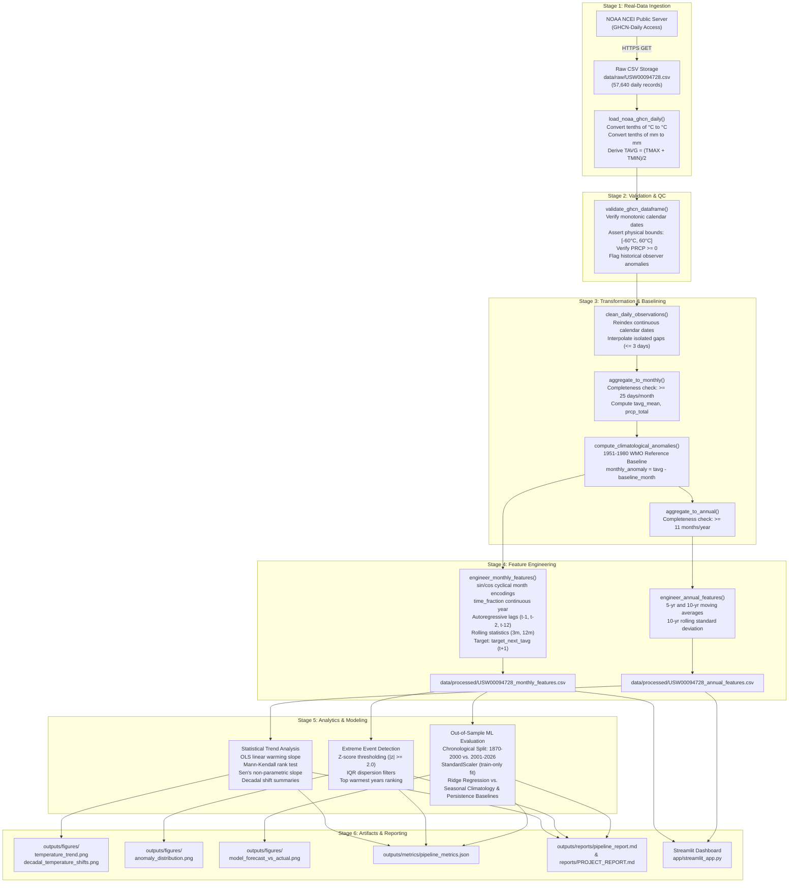

# End-to-End Data Flow Architecture

This document tracks the complete lifecycle of genuine climate observation records through the **Climate Trend Analyzer** processing, analysis, and modeling pipelines.

**Author**: Akash Das

---

## 1. Data Pipeline Overview

The system processes meteorological observations through six deterministic stages:

---

## 2. Detailed Data Lifecycle Stages

### Stage 1: Data Ingestion (`src/climate_analyzer/ingest.py`)
- **Input**: NOAA GHCN-Daily station file (`USW00094728.csv`) retrieved via HTTPS from NOAA NCEI.
- **Transformations**:
  - `TMAX` and `TMIN` are stored by NOAA in tenths of degrees Celsius; divided by $10.0$ to produce standard °C.
  - `PRCP` is stored in tenths of millimetres; divided by $10.0$ to produce standard millimetres.
  - `TAVG` is provided by NOAA for only 2,648 days (1998–2005). For all other records, `TAVG` is derived as the midpoint:
    $$T_{\text{avg}} = \frac{T_{\text{max}} + T_{\text{min}}}{2.0}$$
- **Output**: Daily DataFrame with 57,640 records spanning January 1, 1869 to October 24, 2026.

### Stage 2: Quality Assertion & Schema Validation (`src/climate_analyzer/validation.py`)
- **Input**: Daily DataFrame.
- **Checks**:
  - Required columns: `date`, `year`, `month`, `day`, `tmax`, `tmin`, `tavg`, `prcp`.
  - Date ordering: Chronologically sorted with zero duplicate timestamps.
  - Sanity bounds: $T \in [-60.0, 60.0]^\circ\text{C}$, $\text{PRCP} \ge 0.0$.
  - Observer anomaly detection: Identifies historical transcription swaps (e.g. 1894-10-05 and 1897-02-07 where $T_{\text{min}} > T_{\text{max}}$).

### Stage 3: Transformation & Baselining (`src/climate_analyzer/transform.py`)
- **Daily Cleaning**: Reindexes over complete calendar days. Flags the 2 isolated historical inverted records via `is_inverted_temp = True` while preserving source values. Interpolates isolated gaps strictly $\le 3$ days (leaving gaps $> 3$ days un-interpolated).
- **Monthly Aggregation**:
  - Aggregates daily temperatures to mean, daily precipitation to sum.
  - Completeness requirement: $\ge 25$ valid days per month. (May 1869 and October 2026 each have 24 observed days, and are correctly filtered out).
  - Reindexes onto continuous monthly calendar sequence to ensure exact lag alignment without phase distortion.
- **1951–1980 Baseline Anomaly Computation**:
  - Calculates 30-year monthly mean for each of the 12 calendar months: $\mu_{\text{baseline}, m}$.
  - Subtracts monthly baseline to compute $\text{Anomaly}_t = T_t - \mu_{\text{baseline}, m}$.
- **Annual Aggregation**:
  - Computes annual mean temperature and anomaly.
  - Completeness requirement: $\ge 11$ complete months per year.

### Stage 4: Feature Engineering (`src/climate_analyzer/features.py`)
- **Monthly Features**:
  - Cyclical encodings: $\sin(2\pi m/12)$ and $\cos(2\pi m/12)$.
  - Decimal time fraction: $\text{year} + (m - 1)/12.0$.
  - Autoregressive lags: $T_{t-1}, T_{t-2}, T_{t-12}$.
  - Rolling windows: 3-month and 12-month rolling means and standard deviations.
  - Target variable: $T_{t+1}$ (`target_next_tavg`).
- **Zero Future-Data Leakage**:
  - At index $t$ (end of month $t$), only observations from month $t$ and prior are used.
  - The target $T_{t+1}$ is strictly from the subsequent month.

### Stage 5: Analytics & Predictive Modeling (`src/climate_analyzer/analysis.py`, `modeling.py`)
- **Statistical Trends**:
  - Parametric OLS linear trend slope on annual anomalies.
  - Non-parametric Mann-Kendall test statistic $S$, variance $\text{Var}(S)$, normalized score $Z$, and two-tailed $p$-value.
  - Sen's slope estimator (median of pairwise slopes).
- **Machine Learning Evaluation**:
  - Chronological target-date split: Training on targets 1870–2000 (1,570 months); testing on targets 2001–2026 (309 months).
  - Preprocessing: `StandardScaler` fit strictly on training set ($t \le 2000$).
  - Models evaluated: Ridge Regression, Seasonal Climatology Baseline, Persistence Baseline.
  - Out-of-sample metrics: RMSE, MAE, $R^2$.

### Stage 6: Serving & Artifact Export (`src/climate_analyzer/visualization.py`, `reporting.py`, `app/`)
- Export 4 publication-quality PNG figures to `outputs/figures/`.
- Export metrics JSON to `outputs/metrics/pipeline_metrics.json`.
- Compile formal reports in `outputs/reports/pipeline_report.md` and `reports/PROJECT_REPORT.md`.
- Serve interactive Streamlit UI in `app/streamlit_app.py`.

