# Project Roadmap & Phase-Wise Execution History

**Project**: Climate Trend Analyzer  
**Project Author**: **Akash Das**  
**Project Root**: `D:\Projects\Data Science\Climate Trend Analyzer`  
**Authoritative Documentation Directory**: [`docs/`](file:///d:/Projects/Data%20Science/Climate%20Trend%20Analyzer/docs)  
**Current Phase**: **Phase 8 (Approved)** $\longrightarrow$ Moving to **Phase 9 (Planned)**

---

## 1. Executive Roadmap Summary

The **Climate Trend Analyzer** project follows a structured, evidence-driven multi-phase engineering lifecycle. This document serves as the master record of project evolution, documenting past implementation phases, auditing results, current phase sign-off criteria, and future delivery milestones.

```mermaid
flowchart TD
    P1[Phase 1: Initial Implementation<br/><i>Superseded - Synthetic</i>] --> P2[Phase 2: Real NOAA Migration<br/><i>Approved</i>]
    P2 --> P3A[Phase 3A: Data Quality Audit<br/><i>Approved</i>]
    P3A --> P3B[Phase 3B: Forecast Sample Audit<br/><i>Approved</i>]
    P3B --> P4A[Phase 4A: Scientific Integrity<br/><i>Approved</i>]
    P4A --> P4B[Phase 4B: Autocorr Inference<br/><i>Approved</i>]
    P4B --> P5A[Phase 5A: Verification & Sign-Off<br/><i>Approved</i>]
    P5A --> P5B[Phase 5B: Evidence Reconciliation<br/><i>Needs Revision</i>]
    P5B --> P5C[Phase 5C: Split Correction & Roadmap<br/><i>Approved</i>]
    P5C --> P6A[Phase 6A: Clean-Env & Reproducibility<br/><i>Approved</i>]
    P6A --> P7A[Phase 7A: Dashboard UX & Interactivity<br/><i>Approved</i>]
    P7A --> P7A_R1[Phase 7A-R1: Consistency & Export Remediation<br/><i>Approved</i>]
    P7A_R1 --> P7A_R2[Phase 7A-R2: Invariance Reconciliation<br/><i>Approved</i>]
    P7A_R2 --> P7A_R2_F1[Phase 7A-R2-F1: Tolerance & Reporting Reconciliation<br/><i>Approved</i>]
    P7A_R2_F1 --> P7B[Phase 7B: Minimal Dashboard Verification<br/><i>Approved</i>]
    P7B --> P8[Phase 8: Documentation & Presentation<br/><i>Approved</i>]
    P8 --> P9[Phase 9: Final Acceptance & Release<br/><i>Planned</i>]
```

---

## 2. Phase-by-Phase Execution & Audit History

### Phase 1: Initial Project Implementation
- **Status**: **Superseded (Not Approved for Release)**
- **Dependencies**: None
- **Purpose & Scope**: Establish initial project directory structure, core module skeleton, Streamlit dashboard prototype, and baseline unit tests.
- **Historical Note & Reality Check**:
  The initial prototype implemented by Antigravity utilized synthetic temperature series generation and Monte Carlo simulated scenarios. While functional as a software demonstration (22 initial tests passed), it lacked scientific validity for real-world climate research. The synthetic data functionality was subsequently deprecated and completely eliminated. It was never approved as a release.
- **Work Completed**:
  - Initial repository layout and virtual environment setup.
  - Draft modules for ingest, transform, analysis, and Streamlit visualization.
- **Outcome / Disposition**: Superseded by Phase 2 real-data mandate.

---

### Phase 2: Real NOAA Data Migration
- **Status**: **Approved** (Independently Verified)
- **Dependencies**: Phase 1 (directory layout and package scaffolding)
- **Purpose & Scope**: Eliminate 100% of synthetic data generators, Monte Carlo simulators, and synthetic fallback code paths. Transition the repository strictly to genuine public climate observations from NOAA GHCN-Daily (`USW00094728`, NYC Central Park, 1869–Present).
- **Work Completed**:
  - Implemented automated NOAA GHCN-Daily HTTP downloader and offline cache loader in [`src/climate_analyzer/ingest.py`](file:///d:/Projects/Data%20Science/Climate%20Trend%20Analyzer/src/climate_analyzer/ingest.py).
  - Ingested 57,640 daily records spanning January 1, 1869 to October 24, 2026.
  - Implemented fail-fast error handling when offline data is absent (strictly zero synthetic fallback).
- **Evidence & Acceptance Criteria**:
  - End-to-end pipeline executed using real NOAA data without network access.
  - 24 unit tests passed without synthetic data dependencies.

---

### Phase 3A: Data Integrity and Temperature Quality Audit
- **Status**: **Approved** (Independently Verified)
- **Dependencies**: Phase 2
- **Purpose & Scope**: Perform a deep-dive audit of NOAA source units, quality control flags, missing measurement intervals, transcription inversions, and operational temperature provenance.
- **Work Completed**:
  - Verified NOAA storage units: tenths of °C for `TMAX`, `TMIN`, and `TAVG`; tenths of mm for `PRCP`.
  - Audited native `TAVG` provenance: identified that native `TAVG` exists for only 2,648 days (1998–2005) and contains 5 corrupted summer days (-17.8 °C / 0 °F with QC flag `G`).
  - Established operational temperature quality policy: $T_{\text{avg}}$ is standardized as the arithmetic midpoint $(T_{\text{max}} + T_{\text{min}}) / 2.0$, computed strictly when both extremes are valid; bad native values never enter the operational series.
  - Preserved 2 historical 19th-century transcription inversions ($T_{\text{min}} > T_{\text{max}}$ on `1894-10-05` and `1897-02-07`) without data mutation; flagged via `is_inverted_temp = True`.
  - Replaced blind interpolation with `interpolate_bounded_gaps(max_gap=3)`, properly leaving the 7-day missing gap in May 1869 un-interpolated.
- **Evidence & Acceptance Criteria**:
  - Automated assertions in [`tests/test_transform.py`](file:///d:/Projects/Data%20Science/Climate%20Trend%20Analyzer/tests/test_transform.py) and [`tests/test_ingest.py`](file:///d:/Projects/Data%20Science/Climate%20Trend%20Analyzer/tests/test_ingest.py).
  - Comprehensive data processing reference created in [`docs/DATA_PROCESSING.md`](file:///d:/Projects/Data%20Science/Climate%20Trend%20Analyzer/docs/DATA_PROCESSING.md).

---

### Phase 3B: Forecast Sample and Model-Metric Validation
- **Status**: **Approved** (Independently Verified)
- **Dependencies**: Phase 3A
- **Purpose & Scope**: Audit feature engineering, temporal aggregation thresholds, lag alignments, and chronological train/test partitioning.
- **Work Completed**:
  - Enforced monthly completeness threshold ($\ge 25$ days/month): properly excluded May 1869 (24 days) and October 2026 (24 days), yielding 1,892 valid complete months.
  - Reindexed monthly series across full calendar span (`1869-01-01` to `2026-09-01`, 1,893 continuous months) with May 1869 preserved as `NaN` to prevent lag phase distortion.
  - Traced exact row drops at feature boundaries: 12 in 1869 (initial lags), 1 in 1870-05 (`tavg_lag_12` missing due to May 1869 gap), 1 in 2026-09 (`target_next_tavg` missing due to incomplete Oct 2026) $\to$ exactly 1,879 valid modeling rows.
  - Identified target-date boundary inconsistency (where splitting by feature year placed a January 2001 target inside training) and escalated to Phase 5C.
- **Evidence & Acceptance Criteria**:
  - Exact row-by-row reconciliation documented in [`docs/FEATURE_ENGINEERING.md`](file:///d:/Projects/Data%20Science/Climate%20Trend%20Analyzer/docs/FEATURE_ENGINEERING.md).

---

### Phase 4A: Scientific Integrity and Trend Interpretation
- **Status**: **Approved** (Independently Verified)
- **Dependencies**: Phase 3B
- **Purpose & Scope**: Audit statistical trend methods, non-parametric hypothesis tests, and scientific attribution claims.
- **Work Completed**:
  - Implemented OLS trend (+0.162 °C/dec), Sen's robust slope (+0.161 °C/dec), and Ordinary Mann-Kendall ($S = +6,882, Z = +10.44, p < 10^{-24}$).
  - Retracted unsupported claims that slope agreement proved "steady, uniform warming" throughout the record.
  - Delineated multi-decadal phases: late 19th-century cold regime (1880s anomaly -1.77 °C), mid-20th-century plateau/cooling (~1940–1970), and post-1980 accelerated warming (+0.36 °C/dec).
  - Explicitly documented single-station attribution limits: an empirical study of a single weather station cannot perform formal causal attribution among external forcing mechanisms (greenhouse gases, sulfate aerosols, AMV, UHI), and one urban station is not a global temperature index.
- **Evidence & Acceptance Criteria**:
  - Decadal analysis in [`src/climate_analyzer/analysis.py`](file:///d:/Projects/Data%20Science/Climate%20Trend%20Analyzer/src/climate_analyzer/analysis.py).
  - Attribution boundaries documented in [`docs/STATISTICAL_ANALYSIS.md`](file:///d:/Projects/Data%20Science/Climate%20Trend%20Analyzer/docs/STATISTICAL_ANALYSIS.md) and [`docs/LIMITATIONS.md`](file:///d:/Projects/Data%20Science/Climate%20Trend%20Analyzer/docs/LIMITATIONS.md).

---

### Phase 4B: Autocorrelation-Robust Statistical Inference
- **Status**: **Approved** (Independently Verified)
- **Dependencies**: Phase 4A
- **Purpose & Scope**: Correct for serial autocorrelation in annual anomaly time series ($\rho_1 \approx 0.616$) to prevent inflated Type I error rates.
- **Work Completed**:
  - Implemented Newey-West Heteroskedasticity and Autocorrelation Consistent (HAC) standard error for OLS with automatic Bartlett lag selection ($L = 4$).
  - Implemented Modified Mann-Kendall test under Yue & Wang (2004) variance correction.
  - Evaluated detrended residual serial correlation ($r_1 = 0.1228$).
- **Evidence & Acceptance Criteria**:
  - Unit tests added in [`tests/test_analysis.py`](file:///d:/Projects/Data%20Science/Climate%20Trend%20Analyzer/tests/test_analysis.py).
  - Both nominal and autocorrelation-adjusted metrics exported to [`outputs/metrics/pipeline_metrics.json`](file:///d:/Projects/Data%20Science/Climate%20Trend%20Analyzer/outputs/metrics/pipeline_metrics.json).

---

### Phase 5A: Final Independent Verification and Sign-Off
- **Status**: **Approved** (Independently Verified)
- **Dependencies**: Phase 4B
- **Purpose & Scope**: First end-to-end verification pass of source code, data integrity, test suite, and Streamlit runtime.
- **Work Completed**:
  - Verified 26 passing unit tests in 6.07s.
  - Executed offline pipeline and verified figure generation.
  - Probed Streamlit runtime endpoints via [`scratch/test_streamlit_runtime.py`](file:///d:/Projects/Data%20Science/Climate%20Trend%20Analyzer/scratch/test_streamlit_runtime.py).
  - Identified reporting nuances in HAC standard error definitions and Modified Mann-Kendall literature framing.
- **Evidence & Acceptance Criteria**:
  - Steps 34–41 logged in [`docs/EXECUTION_LOG.md`](file:///d:/Projects/Data%20Science/Climate%20Trend%20Analyzer/docs/EXECUTION_LOG.md).

---

### Phase 5B: Final Evidence Reconciliation and Release Readiness Audit
- **Status**: **Needs Revision**
- **Dependencies**: Phase 5A
- **Purpose & Scope**: Reconcile default HAC standard error reporting ($0.01286$ vs $0.01295$ °C/dec), detail published Modified Mann-Kendall methods, verify sample counts, and prepare release readiness deliverable.
- **Audit Finding & Reason for "Needs Revision"**:
  While the mathematical reconciliation of HAC standard errors and literature citations was achieved, inspection of the forecast date breakdown revealed that splitting by feature year (`df["year"] <= 2000`) caused the December 2000 feature row to predict January 2001, meaning the training set contained a target in 2001 despite being labeled as ending in 2000. Additionally, formal project roadmap integration was outstanding. Consequently, Phase 5B was appropriately rejected and marked **Needs Revision**.
- **Disposition**: Transferred required corrections directly into Phase 5C.

---

### Phase 5C: Forecast Split Correction and Project Roadmap Integration
- **Status**: **Approved** (Independently Verified)
- **Dependencies**: Phase 5B
- **Purpose & Scope**: Resolve training/test target-date boundary inconsistency, adopt strict target-date split policy, recompute all affected metrics, expand unit test assertions to boundary dates, reconcile statistical reporting conventions, create authoritative project roadmap, and synchronize all documentation.
- **Work Completed**:
  1. **Target-Date Split Policy Implementation**:
     - Updated [`src/climate_analyzer/features.py`](file:///d:/Projects/Data%20Science/Climate%20Trend%20Analyzer/src/climate_analyzer/features.py) to explicitly compute `target_date`, `target_year`, and `target_month`.
     - Updated [`src/climate_analyzer/modeling.py`](file:///d:/Projects/Data%20Science/Climate%20Trend%20Analyzer/src/climate_analyzer/modeling.py) to partition by `target_year`:
       - Training Partition: Feature months `1870-01` to `2000-11` predicting Target months `1870-02` to `2000-12` (**1,570 samples**).
       - Held-Out Test Partition: Feature months `2000-12` to `2026-08` predicting Target months `2001-01` to `2026-09` (**309 samples**).
       - Total modeling samples: $1,570 + 309 = 1,879$ (100% sample conservation).
       - Zero forward-looking leakage: December 2000 feature row predicts January 2001 using strictly historical observations.
  2. **Model Re-Estimation & Rescoring (309 Held-Out Test Months)**:
     - **Ridge ML Regressor**: RMSE = **1.6736 °C**, MAE = **1.3347 °C**, $R^2 = \mathbf{0.9625}$.
     - **Seasonal Climatology Baseline**: RMSE = **2.1434 °C**, MAE = **1.6600 °C**, $R^2 = \mathbf{0.9385}$.
     - **Persistence Baseline**: RMSE = **4.8472 °C**, MAE = **4.2573 °C**, $R^2 = \mathbf{0.6856}$.
     - **Relative Error Reduction**: **21.92% RMSE reduction** over Climatology (**39.04% MSE variance reduction**).
  3. **Unit Test Suite Expansion & Boundary Date Assertions**:
     - Updated [`tests/test_modeling.py`](file:///d:/Projects/Data%20Science/Climate%20Trend%20Analyzer/tests/test_modeling.py) to explicitly assert boundary dates for features and targets (`1870-01` to `2000-11` $\to$ `1870-02` to `2000-12` for train; `2000-12` to `2026-08` $\to$ `2001-01` to `2026-09` for test).
     - Test suite expanded to **29 passing unit tests**.
  4. **Statistical Reporting Reconciliation**:
     - Standardized Newey-West HAC convention: default asymptotic SE = $0.01286$ °C/dec ($t = 12.58$) and finite-sample corrected SE = $0.01295$ °C/dec ($t = 12.50$) reported side-by-side with Student's $t$ $p < 10^{-24}$ ($\text{df} = 155$). Replaced "invariantly stable" claims with "relatively stable over the tested lags ($0.0124$ to $0.0130$ °C/dec for $L \ge 1$)".
     - Reconciled Modified Mann-Kendall: properly cited Yue & Wang (2004), Hamed & Rao (1998), and Bayazit & Önöz (2007). Separated Ordinary Mann-Kendall ($S = +6,882, Z = +10.44, p < 10^{-24}$) as primary result from provisional raw AR(1) ($Z^* = +5.09$) and detrended residual AR(1) ($Z^* = +9.23$) sensitivity diagnostics. Retracted raw VIF as a universal upper bound; documented that sample white-noise band alone does not prove lack of complex persistence.
  5. **Roadmap & Master Documentation Synchronization**:
     - Authored [`docs/PROJECT_ROADMAP.md`](file:///d:/Projects/Data%20Science/Climate%20Trend%20Analyzer/docs/PROJECT_ROADMAP.md).
     - Synchronized [`docs/MODEL_METHODOLOGY.md`](file:///d:/Projects/Data%20Science/Climate%20Trend%20Analyzer/docs/MODEL_METHODOLOGY.md), [`docs/FEATURE_ENGINEERING.md`](file:///d:/Projects/Data%20Science/Climate%20Trend%20Analyzer/docs/FEATURE_ENGINEERING.md), [`docs/STATISTICAL_ANALYSIS.md`](file:///d:/Projects/Data%20Science/Climate%20Trend%20Analyzer/docs/STATISTICAL_ANALYSIS.md), [`docs/DASHBOARD_AND_OUTPUTS.md`](file:///d:/Projects/Data%20Science/Climate%20Trend%20Analyzer/docs/DASHBOARD_AND_OUTPUTS.md), [`docs/DATA_FLOW.md`](file:///d:/Projects/Data%20Science/Climate%20Trend%20Analyzer/docs/DATA_FLOW.md), [`docs/DECISIONS_AND_CHANGES.md`](file:///d:/Projects/Data%20Science/Climate%20Trend%20Analyzer/docs/DECISIONS_AND_CHANGES.md) (ADR-11), [`docs/PROJECT_STATUS.md`](file:///d:/Projects/Data%20Science/Climate%20Trend%20Analyzer/docs/PROJECT_STATUS.md), [`docs/EXECUTION_LOG.md`](file:///d:/Projects/Data%20Science/Climate%20Trend%20Analyzer/docs/EXECUTION_LOG.md), and root [`README.md`](file:///d:/Projects/Data%20Science/Climate%20Trend%20Analyzer/README.md).
- **Evidence & Acceptance Criteria**:
  - `python -m pip check` passed with zero broken dependencies.
  - `python -m pytest -q` passed (29 passed in 4.53s).
  - `python run_pipeline.py --station USW00094728 --offline` executed with exit code 0; regenerated metrics JSON, markdown reports, and publication figures.

---

### Phase 6A: Clean-Environment and Reproducibility Audit
- **Status**: **Approved** (Independently Verified)
- **Dependencies**: Phase 5C
- **Purpose & Scope**: Audit project reproducibility, declared vs actual dependencies, clean virtual environment installation, offline fail-fast behavior, and numerical determinism without risking existing local environments.
- **Work Completed**:
  1. **Dependency Audit & Alignment**:
     - Audited declared dependencies in `pyproject.toml` and `requirements.txt` against direct Python AST imports across `src/`, `app/`, `tests/`, and `run_pipeline.py`.
     - Confirmed all direct third-party imports (`numpy`, `pandas`, `scipy`, `scikit-learn`, `matplotlib`, `seaborn`, `streamlit`, `pytest`) are declared.
     - Confirmed `pip check` reports zero broken requirements in both project `.venv` and clean temporary verification environments.
  2. **Isolated Clean Environment Verification (`cta_clean_env`)**:
     - Built an isolated temporary virtual environment outside repository source and documentation directories (`$env:TEMP\cta_clean_env`, Python 3.11.0).
     - Verified clean installation of all declared dependencies from `requirements.txt` and editable project installation (`pip install -e . --no-build-isolation`).
     - Verified successful package import: `import climate_analyzer; print(climate_analyzer.__version__)` $\to$ `0.2.0`.
     - Verified test discovery and execution: `python -m pytest -q` $\to$ **29 passed in 7.01s**.
     - Verified offline pipeline execution: `python run_pipeline.py --station USW00094728 --offline` $\to$ exit code 0.
     - Verified Streamlit dashboard startup: `_stcore/health` returned HTTP 200 (`ok`); main route `/` returned HTTP 200 (`6,467 bytes`).
  3. **Numerical Determinism & Reproducibility**:
     - Audited numerical determinism across repeated offline pipeline runs using `outputs/metrics/pipeline_metrics.json`.
     - Confirmed 100% exact numerical determinism across all scientific outputs: OLS linear trend (+0.162 °C/dec, $R^2 = 0.5714$, nominal $p < 10^{-24}$), HAC asymptotic SE ($0.01286$ °C/dec, $t = 12.58$) and finite-sample SE ($0.01295$ °C/dec, $t = 12.50$), Sen's slope (+0.161 °C/dec), Mann-Kendall ($S = 6,882, Z = 10.44$), Modified Mann-Kendall (raw AR1 $Z^* = 5.09$, detrended residual $Z^* = 9.23$), held-out model evaluation on 309 target months (Ridge RMSE = 1.6736 °C, MAE = 1.3347 °C, $R^2 = 0.9625$; Climatology RMSE = 2.1434 °C; Persistence RMSE = 4.8472 °C).
  4. **Offline Fail-Fast Guarantees**:
     - Verified that executing `--offline` with missing raw data or invalid station code immediately halts with clear error diagnostics and exit code 1.
     - Confirmed zero network access during offline pipeline execution and strictly zero synthetic data fallback.
- **Evidence & Acceptance Criteria**:
  - `pip check`: 0 broken dependencies in both `.venv` and clean temp environment.
  - Test suite: 29 passed in both `.venv` (4.53s) and clean temp environment (7.01s).
  - Offline pipeline: exit code 0 on real NOAA observations (`USW00094728`); exit code 1 on missing station data.
  - Bit-for-bit numerical determinism confirmed.

---

### Phase 7A: Streamlit Dashboard Interactivity, Responsive Layout, and User Experience Audit
- **Status**: **Approved** (Independently Verified)
- **Dependencies**: Phase 6A
- **Purpose & Scope**: Transform the Streamlit dashboard from a static demonstration into an interactive, scientifically rigorous, responsive research interface with genuine dynamic controls, multi-baseline selection, historical era filtering, transparent data integrity cards, and clean CSV export capabilities.
- **Work Completed**:
  1. **Interactive Controls & Caching Architecture**:
     - Fixed global parameter capture inside `@st.cache_data`: split data pipeline into base ingestion (`load_and_clean_base_observations`) and parameterized feature engineering (`compute_parameterized_features`) parameterized by `(st_id, b_start, b_end, w1, w2)`.
     - Implemented dynamic **Climatological Baseline Selector**: WMO Standard (1951–1980), 20th Century (1901–2000), Modern Normal (1991–2020), Early Historical (1871–1900), and Custom.
     - Implemented dynamic **Historical Era Filter**: dual year-range slider (1869–2026) with quick era presets ("Full Record", "Post-1970 Warming Era", "20th Century", "Early Historical"). Recomputes OLS linear trends and Sen's slope dynamically on the active year subset.
     - Implemented configurable moving average sliders (3–10 yrs and 10–30 yrs) and Z-score anomaly threshold ($|z| \in [1.5, 3.5]$).
     - Implemented forecast evaluation protocol selector: distinguishes official `Validated Benchmark (Targets 2001–2026, 309 Held-Out Months)` from `Exploratory Split Year (Custom Scenario)`.
  2. **Data Integrity & Provenance Transparency**:
     - Added dedicated provenance card displaying station coordinates (Lat 40.78° N, Lon -73.97° W, Elev 42.7m), physical units (°C, mm), operational temperature definition ($T_{\text{mid}} = (T_{\text{max}} + T_{\text{min}}) / 2.0$), completeness rules ($\ge 25$ days/mo, un-interpolated May 1869 gap), and the strict zero-synthetic-data guarantee.
     - Synchronized 5-column responsive KPI metric row: Active Period, Valid Months, Linear Warming Rate with Newey-West HAC standard error, Sen's Robust Median Slope, and Mann-Kendall trend status.
  3. **Multi-Tab Layout & Standardized CSV Exports**:
     - **Tab 1 (Historical Trends)**: Anomaly timeline with dynamic baseline title, statistical diagnostics expander (HAC asymptotic vs finite-sample SE, Sen, MK, Yue-Wang), and `Download Filtered Annual Trends CSV`.
     - **Tab 2 (Anomaly & Extreme Detection)**: Monthly anomaly distribution, highlighted extreme events exceeding $|z| > \text{cutoff}$, extreme counts, warmest/coldest year tables, and `Download Detected Monthly Extremes CSV`.
     - **Tab 3 (Decadal Shifts)**: Decadal progression bar chart, comprehensive statistical summary table, and `Download Decadal Climate Summary CSV`.
     - **Tab 4 (ML Forecasting)**: 3-model benchmark cards (Ridge RMSE 1.674 °C, Climatology 2.143 °C, Persistence 4.847 °C; 21.92% RMSE error reduction), forecast vs observation plot, standardized feature importance weights table, and `Download Out-of-Sample Predictions CSV`.
     - **Tab 5 (Verified Pipeline Metrics)**: Live inspector displaying authoritative JSON metrics from `outputs/metrics/pipeline_metrics.json`.
     - All CSV exports include clear physical units in headers (`mean_annual_temp_degC`, `temperature_anomaly_degC`, `moving_avg_5yr_degC`, `baseline_period`, `station_id`).
  4. **Automated Testing Suite Expansion**:
     - Authored [`tests/test_dashboard.py`](file:///d:/Projects/Data%20Science/Climate%20Trend%20Analyzer/tests/test_dashboard.py) covering AST syntax, dynamic baseline recalculation, date-range filtering, CSV schema & unit tags, ML benchmark reconciliation, and missing-data fail-fast behavior.
     - Test suite expanded to **35 passing unit tests** (up from 29).
  5. **Phase 6A Follow-Up Resolution**:
     - Successfully resolved and verified cleanup of temporary verification environments (`$env:TEMP\cta_clean_env` and `scratch/clean_venv` confirmed deleted).
- **Evidence & Acceptance Criteria**:
  - `python -m pytest -q`: **35 passed in 3.38s**.
  - `python scratch/test_streamlit_runtime.py`: Verified `/_stcore/health` (HTTP 200, `ok`) and `/` (HTTP 200, 6,467 bytes).
  - All 4 CSV export buttons tested and validated for schema and physical units.
  - Zero synthetic data fallbacks.

---

### Phase 7A-R1: Dashboard Scientific Consistency and Export Integrity Remediation
- **Status**: **Approved** (Independently Verified)
- **Dependencies**: Phase 7A
- **Purpose & Scope**: Resolve acceptance questions from Phase 7A regarding forecast export integrity, baseline invariance, moving-average CSV headers, and 3-tiered verification evidence.
- **Work Completed**:
  1. **Forecast Benchmark & Export Partitioning**:
     - Preserved official benchmark target-date partition: training targets Feb 1870–Dec 2000 (1,570 samples), held-out test targets Jan 2001–Sep 2026 (309 samples).
     - Derived and integrated `target_date` in model predictions and exports.
     - Enforced distinct file naming: benchmark export named `{station_id}_ml_benchmark_predictions_2001_2026_309months.csv` with `forecast_protocol = "validated_benchmark"`; exploratory scenario named `{station_id}_ml_exploratory_predictions_split{split_yr}.csv` with `forecast_protocol = "exploratory_scenario"`.
     - Standardized forecast CSV schema: `feature_date`, `target_date`, `actual_observed_tavg_degC`, `predicted_ridge_ml_degC`, `predicted_climatology_degC`, `predicted_persistence_degC`, `forecast_residual_degC`, `split_year`, `forecast_protocol`, `station_id`.
  2. **Baseline Invariance Proof & Verification**:
     - Proved and regression-tested that subtracting constant monthly baselines leaves OLS decadal slope (+0.162 °C/dec), Sen's median slope (+0.161 °C/dec), Newey-West HAC standard errors (0.01286 °C/dec), and Mann-Kendall statistics mathematically identical.
     - Verified that anomaly values, metric card displays, and extreme threshold counts dynamically recalculate across 1951–1980 WMO, 1901–2000 20th Century, 1991–2020 Modern Normal, and 1871–1900 Early Historical baselines.
  3. **Dynamic Moving-Average Headers**:
     - Configured annual export columns to dynamically encode slider-selected window sizes (`moving_avg_{w1}yr_degC`, `moving_avg_{w2}yr_degC`).
  4. **Three-Tiered Control Verification**:
     - Structured verification into Level 1 (unit/calculation tests), Level 2 (runtime server/HTTP probes), and Level 3 (headless browser E2E, deferred to Phase 7B).
  5. **Automated Testing Suite Expansion**:
     - Added 4 new regression tests to [`tests/test_dashboard.py`](file:///d:/Projects/Data%20Science/Climate%20Trend%20Analyzer/tests/test_dashboard.py) covering baseline invariance, moving average window configurations, forecast export partitioning, and exploratory scenario isolation.
     - Test suite expanded to **39 passing unit tests** (up from 35).
- **Evidence & Acceptance Criteria**:
  - `python -m pytest -q`: **39 passed in 4.86s**.
  - `python scratch/test_streamlit_runtime.py`: Verified `/_stcore/health` (HTTP 200, `ok`) and `/` (HTTP 200, 6,467 bytes).
  - Clean pip environment: `pip check` confirmed zero broken requirements.
  - End-to-end offline pipeline: `run_pipeline.py --station USW00094728 --offline` passed cleanly.

---

### Phase 7A-R2: Baseline Invariance Reconciliation and Statistical Acceptance Gate
- **Status**: **Approved** (Independently Verified)
- **Dependencies**: Phase 7A-R1
- **Purpose & Scope**: Resolve the discrepancy between the claimed mathematical baseline invariance and the reported 5th/6th decimal place slope variations in Phase 7A-R1. Establish explicit conditioning for bit-for-bit invariance vs. incomplete year seasonal leverage effects.
- **Work Completed**:
  1. **Discrepancy Root Cause Analysis & Mathematical Proof**:
     - Identified that the 5th/6th decimal slope differences on the full 157-year operational record (1869–2025) arise because year 1869 has 11 valid months (missing May due to the authentic 7-day observation gap).
     - Because historical greenhouse warming and urbanization in NYC are seasonally non-uniform across calendar months (winter warmed by $+1.0$ to $+1.5$ °C; May warmed by $+0.34$ °C), the 11-month average baseline offset for 1869 deviates from the 12-month average offset by $\delta \approx -0.025$ °C to $+0.039$ °C.
     - Proved that at boundary year 1869 ($t - \bar{t} = -78$), this creates an analytical OLS leverage perturbation $\Delta \hat{\beta} = 10 \cdot (1869 - \bar{t}) \cdot \delta / \sum (t - \bar{t})^2 \approx \pm 0.00009$ °C/decade. The analytical formula predicts the actual OLS slope differences down to $10^{-8}$ °C/decade.
  2. **Like-for-Like Complete Sample Invariance Verified**:
     - Demonstrated that on any sample of complete calendar years (such as 1870–2025, N=156, or filtered eras like 1970–2025, N=56, or 1901–2000, N=100), baseline transformation is a pure scalar constant translation.
     - Proved and tested that OLS slope ($0.1616656417$ °C/dec), Sen's slope ($0.1605398819$ °C/dec), HAC standard error ($0.013189$ °C/dec), and Mann-Kendall score ($S = 6754, Z = 10.348448$) are **bit-for-bit identical ($< 10^{-14}$)** across all baselines.
  3. **Universal 3-Decimal Precision Invariance**:
     - Confirmed that at standard climatological reporting precision (3 decimal places), OLS is universally **$+0.162$ °C/decade** and Sen's slope is universally **$+0.161$ °C/decade** across all baselines on both the 156-year and 157-year samples.
  4. **Regression Testing Suite Expansion**:
     - Added `test_linear_trend_and_sens_constant_shift_invariance` to `tests/test_analysis.py`.
     - Added `test_1869_incomplete_year_leverage_reconciliation` and `test_dashboard_pathway_invariance_and_display_agreement` to `tests/test_dashboard.py`.
     - Test suite expanded to **42 passing unit tests** (up from 39).
- **Evidence & Acceptance Criteria**:
  - `python -m pytest -q`: **42 passed in 5.76s**.
  - `python scratch/test_streamlit_runtime.py`: Verified `/_stcore/health` (HTTP 200, `ok`) and `/` (HTTP 200, 6,467 bytes).
  - `run_pipeline.py --station USW00094728 --offline`: Executed cleanly, output artifacts synchronized.
  - Zero synthetic data, zero unjustified analytical modifications.

---

### Phase 7A-R2-F1: Final Statistical Tolerance and Reporting Reconciliation
- **Status**: **Approved** (Independently Verified)
- **Dependencies**: Phase 7A-R2
- **Purpose & Scope**: Perform a final, narrow-scope audit of the full-record (1869–2025, N=157) vs. complete-year (1870–2025, N=156) baseline comparison. Correct inaccurate tolerance claims, distinguish unrounded numerical differences from rounded display equality, and verify the exact mechanism for the Mann-Kendall score difference between Early Historical ($S = 6880$) and WMO ($S = 6882$).
- **Work Completed**:
  1. **Newey-West HAC Standard Error Span & Correction**:
     - Audited full-precision values: WMO `0.01286389`, 20th Cent `0.01286417` ($\Delta = +0.00000028$), Modern `0.01285721` ($\Delta = -0.00000668$), Early `0.01287465` ($\Delta = +0.00001075$).
     - Corrected prior claim of "no more than $\pm 0.00001$": maximum difference relative to WMO is $+0.00001075$ °C/decade and total span is $0.00001744$ °C/decade.
     - Confirmed all round identically to `0.0129` °C/decade at 4 decimal places.
  2. **Sen's Slope Tolerance & Precision Distinction**:
     - Audited full-precision values: WMO `0.16102871`, 20th Cent `0.16102871`, Modern `0.16103801` ($\Delta = +0.00000930$), Early `0.16079352` ($\Delta = -0.00023519$).
     - Reconciled tolerance: unrounded difference reaches $-0.00023519$ °C/decade (span $0.00024449$ °C/decade), correcting prior claims of $\pm 0.0001$.
     - Explicitly distinguished from display equality: at 3 decimal places, all baselines universally round to `+0.161 °C / dec` with zero display discrepancy.
  3. **Mann-Kendall Score Mechanism Verification & Refutation of Ties**:
     - Proved that Kendall variance $\text{var}(S) = 434,052.6667$ is identical across all baselines, establishing that zero ties exist (disproving the tied-ranks hypothesis).
     - Proved that out of all 12,246 pairs, exactly 1 pair flips sign: pair `(1869, 1882)`. In WMO, $y(1882) - y(1869) = +0.0084$ °C ($\text{sign} = +1$); in Early Historical, 1869's missing-May seasonal baseline shift of $+0.0386$ °C shifts this difference to $-0.0302$ °C ($\text{sign} = -1$). Flipping this single pair changes $S$ by $(-1) - (+1) = -2$, exactly accounting for $S = 6880$ vs $S = 6882$.
  4. **Regression Testing & Documentation**:
     - Added `test_full_record_statistical_tolerances_and_mk_mechanism` to `tests/test_dashboard.py` (now 13 tests, 43 total suite tests).
     - Updated `docs/DASHBOARD_AND_OUTPUTS.md`, `docs/TESTING.md`, `docs/PROJECT_ROADMAP.md`, `docs/PROJECT_STATUS.md`, and `docs/EXECUTION_LOG.md`.
- **Evidence & Acceptance Criteria**:
  - `python -m pytest -q`: **43 passed in 10.16s**.
  - `python run_pipeline.py --station USW00094728 --offline`: Synchronized.

---

### Phase 7B: Minimal Dashboard Verification
- **Status**: **Approved** (Independently Verified)
- **Dependencies**: Phase 7A-R2-F1
- **Purpose & Scope**: Perform a minimal practical check that the current Streamlit dashboard works correctly before proceeding to Phase 8. Verify live launch, desktop and mobile viewport rendering, key interactive control reactivity, data export integrity, and full test suite regression health.
- **Work Completed**:
  1. **Live Application Launch & Health Probing**:
     - Launched Streamlit application on local port using project-local `.venv`.
     - Probed `/_stcore/health` (HTTP 200, payload `'ok'`) and main route `/` (HTTP 200, 6,467 bytes). Zero startup crashes or uncaught exceptions.
  2. **Headless Browser Desktop & Mobile Viewport Inspection**:
     - Rendered dashboard at desktop viewport (1280x900) via headless Chrome (`dashboard_desktop_1280px.png`). Confirmed wide 5-column top KPI card layout, expandable provenance header, sidebar controls, and tab navigation.
     - Rendered dashboard at mobile viewport (375x812) via headless Chrome (`dashboard_mobile_375px.png`). Confirmed responsive vertical stacking of metric cards and collapsible sidebar navigation drawer without content clipping.
  3. **Key Interactive Control Testing**:
     - Tested historical era filtering interaction: adjusted active analysis era from Full Record (1869–2026, N=157) to Post-1970 Warming Era (1970–2026, N=56).
     - Verified that warming rate dynamically accelerated from $+0.162$ °C/decade (OLS) / $+0.161$ °C/decade (Sen) to $+0.216$ °C/decade (OLS) / $+0.221$ °C/decade (Sen).
     - Confirmed zero errors during recalculation.
  4. **Data Export Integrity**:
     - Exported Tab 1 Filtered Annual Trends CSV (`USW00094728_annual_trends_1869_2026_test_export.csv`).
     - Re-read and verified 157 rows, explicit physical unit column headers (`mean_annual_temp_degC`, `temperature_anomaly_degC`, `moving_avg_5yr_degC`, `moving_avg_10yr_degC`), station ID, baseline period metadata, and 0 missing values.
  5. **Regression Verification**:
     - Executed `pip check` (clean, 0 broken requirements).
     - Executed `pytest -q` (**43 passed in 7.10s**).
- **Evidence & Acceptance Criteria**:
  - `verify_phase7b_dashboard.py`: Executed cleanly with all checks passed.
  - `outputs/figures/dashboard_desktop_1280px.png` and `outputs/figures/dashboard_mobile_375px.png` generated and verified.
  - `pip check` & `pytest -q`: Clean exit code 0.

---

### Phase 8: Portfolio Documentation, GitHub Readiness, and Repository Publishing
- **Status**: **Approved** (Independently Verified)
- **Dependencies**: Phase 7B
- **Purpose & Scope**: Transform the repository into a production-grade, reproducible, secure, and GitHub-ready project. Author comprehensive root `README.md` meeting professional standards (zero emojis, zero em dashes, 20 required sections), resolve Phase 7B date-label discrepancies, preserve visual screenshot assets in `Images/`, perform mandatory security review, initialize Git repository, and provide beginner-friendly GitHub publishing instructions.
- **Work Completed**:
  1. **Professional Root README.md**:
     - Authored complete 20-section technical documentation covering project overview, WMO baselines, OLS + Newey-West HAC mathematics, Yue & Wang Modified Mann-Kendall test, target-date partitioned Ridge regression benchmarks, and verified execution commands.
     - Enforced strict writing standards: zero emojis, zero em dashes, no invented badges/URLs, and verified relative image links (`Images/dashboard_desktop.png`, `Images/temperature_trend.png`, etc.).
  2. **Phase 7B Date-Label Discrepancy Resolution**:
     - Audited observation bounds: daily records span 1869 to 2026 (57,640 days), but monthly aggregates for 2026 end in September (9 months), falling short of the WMO $\ge 11$ months threshold for annual aggregation.
     - Updated `app/streamlit_app.py`: presets set to Full Record (1869–2025, 157 Annual Records) and Post-1970 Warming Era (1970–2025, 56 Years); annual slider max set to 2025; KPI card explicitly distinguishes between active monthly count and 57,640 total daily observations (1869–2026); CSV export filenames dynamically bind to `ann_min_yr` and `ann_max_yr` (`1869_2025.csv` and `1970_2025.csv`).
  3. **Images Directory Asset Preservation**:
     - Preserved publication-quality PNG figures and actual dashboard screenshots in `Images/` (`dashboard_desktop.png`, `dashboard_mobile.png`, `dashboard_tablet.png`, `temperature_trend.png`, `model_forecast_vs_actual.png`, `anomaly_distribution.png`, `decadal_temperature_shifts.png`, `.gitkeep`).
  4. **Mandatory Security Audit**:
     - Scanned repository source files, notebooks, scripts, configs, and documentation for API keys, passwords, tokens, private connection strings, and certificates.
     - Confirmed zero exposed secrets. `.env` and `.env.*.local` remain git-ignored; safe `.env.example` template provided.
  5. **Git Repository Initialization & Clean Boundary**:
     - Initialized local repository (`git init -b main`).
     - Verified `.gitignore` excludes `.venv/`, `.env`, temporary caches, and candidate-private notes (`docs/*INTERVIEW*`, `docs/*PREP*`).
     - Prepared initial release commit (`v0.4.0`) while halting at the remote boundary for user authorization.
  6. **Regression Verification**:
     - Executed `pytest -q`: **43 passed in 7.10s** (100%).
     - Executed `pip check`: Clean exit code 0.
- **Evidence & Acceptance Criteria**:
  - `README.md`: Verified 0 emojis, 0 em dashes, 20 sections present, all image links resolved.
  - `Images/`: 7 PNG visual assets and `.gitkeep` verified.
  - Security scan: Clean, 0 secrets.
  - `pip check` & `pytest -q`: Clean exit code 0.

---

## 3. Forward Plan: Upcoming Phases (Phase 9)

### Phase 9: Final Acceptance and Release
- **Status**: **Planned**
- **Dependencies**: Phase 8
- **Purpose & Scope**: Formal project acceptance and release sign-off by author **Akash Das**, tagging production release `v1.0.0`.
- **Main Work Planned**:
  - Formal sign-off review meeting.
  - Git tag `v1.0.0` creation and release notes publication.
  - Distribution of project artifacts.
- **Acceptance Criteria**: Formal sign-off and approval by Akash Das.

---

## 4. Master Phase Status Summary Table

| Phase ID | Phase Name | Status | Verified Evidence / Next Milestone |
| :--- | :--- | :---: | :--- |
| **Phase 1** | Initial Project Implementation | **Superseded** | Synthetic data prototype superseded; never released. |
| **Phase 2** | Real NOAA Data Migration | **Approved** | 57,640 real GHCN-Daily records ingested; zero synthetic code. |
| **Phase 3A** | Data Integrity & Temperature Quality Audit | **Approved** | Bounded gaps ($\le 3$ days), inversion flagging, QC flag `G` isolated. |
| **Phase 3B** | Forecast Sample & Model Validation | **Approved** | 1,892 complete months, 14 boundary exclusions $\to$ 1,879 valid rows. |
| **Phase 4A** | Scientific Integrity & Trend Interpretation | **Approved** | OLS +0.162 °C/dec; steady warming retracted; attribution limits set. |
| **Phase 4B** | Autocorrelation-Robust Statistical Inference | **Approved** | Newey-West HAC ($L=4$) and Modified Mann-Kendall implemented. |
| **Phase 5A** | Final Independent Verification & Sign-Off | **Approved** | Test suite, offline pipeline, and Streamlit health verified. |
| **Phase 5B** | Evidence Reconciliation & Release Audit | **Needs Revision** | Target-date boundary mismatch identified; escalated to 5C. |
| **Phase 5C** | Forecast Split Correction & Roadmap | **Approved** | Target-date split implemented (1,570 train / 309 test); 29 tests passed. |
| **Phase 6A** | Reproducibility & Clean-Env Validation | **Approved** | Clean temp env installation tested; 100% determinism verified. |
| **Phase 7A** | Dashboard Interactivity & UX Audit | **Approved** | Dynamic baselines, era filters, 4 CSV downloads; 35 tests passed. |
| **Phase 7A-R1** | Dashboard Consistency & Export Remediation | **Approved** | Forecast target-date exports, baseline invariance verified; 39 tests passed. |
| **Phase 7A-R2** | Baseline Invariance Reconciliation | **Approved** | 1869 seasonal leverage reconciled, bit-for-bit invariance verified on N=156; 42 tests passed. |
| **Phase 7A-R2-F1** | Tolerance & Reporting Reconciliation | **Approved** | Exact HAC SE span ($0.000017$), unrounded Sen diff ($0.000235$), MK pairwise sign flip verified; 43 tests passed. |
| **Phase 7B** | Minimal Dashboard Verification | **Approved** | Live HTTP 200, desktop (1280x900) & mobile (375x812) verified, post-1970 era interaction, CSV export; 43 tests passed. |
| **Phase 8** | Portfolio Documentation & Publishing Readiness | **Approved** | Complete 20-section README (0 emojis/em dashes), date labels fixed, security scan clean, git initialized; 43 tests passed. |
| **Phase 9** | Final Acceptance & Release | **Planned** | Formal author sign-off by Akash Das and v1.0.0 release tagging. |

