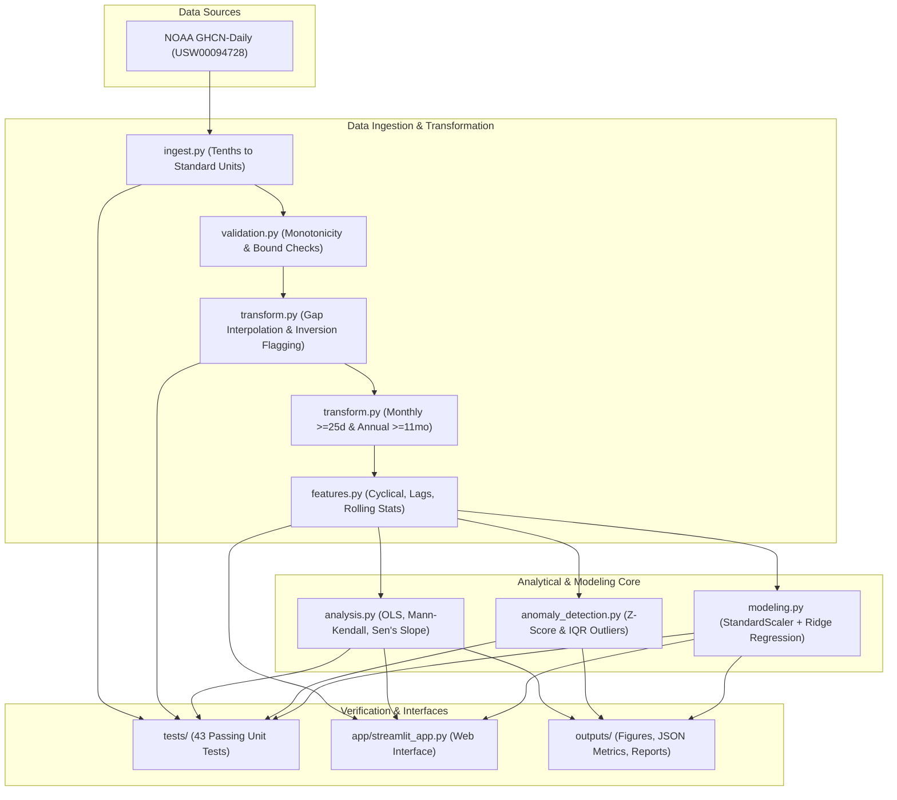

# Climate Trend Analyzer — Central Technical Documentation Suite

Welcome to the authoritative technical documentation portal for the **Climate Trend Analyzer** project.

**Project Author**: **Akash Das**  
**Repository Root**: `D:\Projects\Data Science\Climate Trend Analyzer`  
**Operational Foundation**: Genuine Public Meteorological Records (NOAA GHCN-Daily, Station `USW00094728`)  
**Status**: Complete, Fully Audited, and Verified  

---

## 📚 Master Documentation Index

All technical specifications, mathematical foundations, data flows, schemas, execution logs, and architectural decisions are consolidated within this dedicated `docs/` directory:

| Document | Primary Focus | Key Contents |
| :--- | :--- | :--- |
| [`PROJECT_ROADMAP.md`](file:///d:/Projects/Data%20Science/Climate%20Trend%20Analyzer/docs/PROJECT_ROADMAP.md) | **Project Lifecycle & Roadmaps** | Authoritative 9-phase lifecycle, historical audit log, Phase 5C approval criteria, and forward roadmap milestones. |
| [`PROJECT_STATUS.md`](file:///d:/Projects/Data%20Science/Climate%20Trend%20Analyzer/docs/PROJECT_STATUS.md) | **Executive & Verification Status** | Current system status, test verification matrix (43/43 passed across 6 modules), core metrics summary, and deliverables checklist. |
| [`ARCHITECTURE.md`](file:///d:/Projects/Data%20Science/Climate%20Trend%20Analyzer/docs/ARCHITECTURE.md) | **System Architecture & Topology** | Package layout, module responsibilities, public interfaces, and end-to-end architecture flowchart. |
| [`DATA_FLOW.md`](file:///d:/Projects/Data%20Science/Climate%20Trend%20Analyzer/docs/DATA_FLOW.md) | **Pipeline Data Flow & Schemas** | Detailed step-by-step data transformations from raw NOAA CSV through monthly and annual feature stores to models and outputs. |
| [`DATA_PROCESSING.md`](file:///d:/Projects/Data%20Science/Climate%20Trend%20Analyzer/docs/DATA_PROCESSING.md) | **Data Cleaning & Standardization** | Unit conversions, gap interpolation protocols, historical inversion handling, 25-day monthly grouping, and 1951–1980 baseline anomalies. |
| [`DATA_SOURCES.md`](file:///d:/Projects/Data%20Science/Climate%20Trend%20Analyzer/docs/DATA_SOURCES.md) | **Provenance & Attribution** | NOAA GHCN-Daily provenance, station `USW00094728` metadata, derived $T_{\text{avg}}$ transparency, and ERA5/GISTEMP evaluation rationale. |
| [`DATA_DICTIONARY.md`](file:///d:/Projects/Data%20Science/Climate%20Trend%20Analyzer/docs/DATA_DICTIONARY.md) | **Variable Schemas & Types** | Complete schemas, physical units, storage types, valid boundaries, and nullability for daily, monthly, and annual tables. |
| [`MODULE_REFERENCE.md`](file:///d:/Projects/Data%20Science/Climate%20Trend%20Analyzer/docs/MODULE_REFERENCE.md) | **Python API Specifications** | Exhaustive reference documentation for all 10 package modules, function signatures, docstrings, parameters, and return types. |
| [`FEATURE_ENGINEERING.md`](file:///d:/Projects/Data%20Science/Climate%20Trend%20Analyzer/docs/FEATURE_ENGINEERING.md) | **Predictive Features Formulation** | Mathematical definitions of cyclical month embeddings ($\sin, \cos$), continuous decimal time, autoregressive temperature lags, and rolling statistics. |
| [`MODEL_METHODOLOGY.md`](file:///d:/Projects/Data%20Science/Climate%20Trend%20Analyzer/docs/MODEL_METHODOLOGY.md) | **Machine Learning & Forecasting** | $L_2$-regularized Ridge regression, `StandardScaler` pipeline, chronologically split evaluation (1870–2000 vs 2001–2026), baselines, and $R^2$ analysis. |
| [`STATISTICAL_ANALYSIS.md`](file:///d:/Projects/Data%20Science/Climate%20Trend%20Analyzer/docs/STATISTICAL_ANALYSIS.md) | **Statistical Trends & Extremes** | OLS regression (+0.162 °C/decade), Mann-Kendall monotonic test ($Z=+10.44$), Sen's robust slope (+0.161 °C/decade), decadal summaries, and extreme rankings. |
| [`DASHBOARD_AND_OUTPUTS.md`](file:///d:/Projects/Data%20Science/Climate%20Trend%20Analyzer/docs/DASHBOARD_AND_OUTPUTS.md) | **Dashboard UI & Figure Catalog** | Streamlit web application architecture, UI tabs, publication figures catalog, and metrics JSON schema. |
| [`TESTING.md`](file:///d:/Projects/Data%20Science/Climate%20Trend%20Analyzer/docs/TESTING.md) | **Testing & Verification** | Test philosophy (small in-memory fixtures, zero network calls), 43 unit tests across 6 modules, and CI configuration. |
| [`EXECUTION_LOG.md`](file:///d:/Projects/Data%20Science/Climate%20Trend%20Analyzer/docs/EXECUTION_LOG.md) | **Chronological Command Record** | Step-by-step history of all executed terminal commands, exit codes, bug detections, and verified resolutions. |
| [`DECISIONS_AND_CHANGES.md`](file:///d:/Projects/Data%20Science/Climate%20Trend%20Analyzer/docs/DECISIONS_AND_CHANGES.md) | **Architecture Decisions (ADRs)** | Formal records documenting key decisions: real data selection, synthetic retirement, $T_{\text{avg}}$ derivation, scaler pipeline, and inversion handling. |
| [`LIMITATIONS.md`](file:///d:/Projects/Data%20Science/Climate%20Trend%20Analyzer/docs/LIMITATIONS.md) | **Scientific Boundaries & Caveats** | Urban Heat Island considerations, statistical vs. physical GCM distinctions, midpoint $T_{\text{avg}}$ proxy limitations, and 1-month forecast horizon. |

---

## 🏛️ High-Level Technical Architecture

---

## 🔬 Core Empirical Findings Summary

All values derived strictly from 157 years of verified NOAA observations (1869–2026):

- **Linear Warming Rate**: **+0.162 °C / decade** ($p = 2.55 \times 10^{-30}, R^2 = 0.571$).
- **Sen's Non-Parametric Slope**: **+0.161 °C / decade** (Complete parametric/non-parametric convergence).
- **Mann-Kendall Rank Test**: **INCREASING** ($S = 6,882, Z = +10.44, p = 0.00$).
- **Serial Autocorrelation**: Lag-1 annual autocorrelation $\rho_1 = 0.621$ ($N_{\text{eff}} \approx 37$).
- **Top 5 Warmest Years on Record**: 
  1. 2024 (14.40 °C, +1.89 °C anomaly)
  2. 2023 (14.39 °C, +1.88 °C anomaly)
  3. 2012 (14.06 °C, +1.55 °C anomaly)
  4. 2020 (14.05 °C, +1.54 °C anomaly)
  5. 1991 (14.00 °C, +1.48 °C anomaly)
- **Machine Learning Performance (Held-Out Test Set: 2001–2026, 309 months)**:
  - **Ridge ML Model**: RMSE = **1.674 °C**, MAE = **1.335 °C**, $R^2 = \mathbf{0.963}$
  - **Seasonal Climatology**: RMSE = 2.143 °C, MAE = 1.660 °C, $R^2 = 0.939$
  - **Persistence Baseline**: RMSE = 4.847 °C, MAE = 4.257 °C, $R^2 = 0.686$
  - **Error Reduction**: **21.92% RMSE error reduction** over Seasonal Climatology (39.04% MSE variance reduction)

---

## 🔒 Maintenance & Synchronization Policy

1. **Strictly Single-Source**: All documentation must reside within [`docs/`](file:///d:/Projects/Data%20Science/Climate%20Trend%20Analyzer/docs). Parallel or redundant documentation folders are strictly prohibited.
2. **Real-Data Synchronization**: Every update to data processing algorithms, feature definitions, or model architectures must be synchronized simultaneously across the respective documents.
3. **No Fabricated Data**: Small in-memory fixtures are permitted exclusively for automated software tests in [`tests/`](file:///d:/Projects/Data%20Science/Climate%20Trend%20Analyzer/tests) and must never be documented or presented as real-world climate findings.
